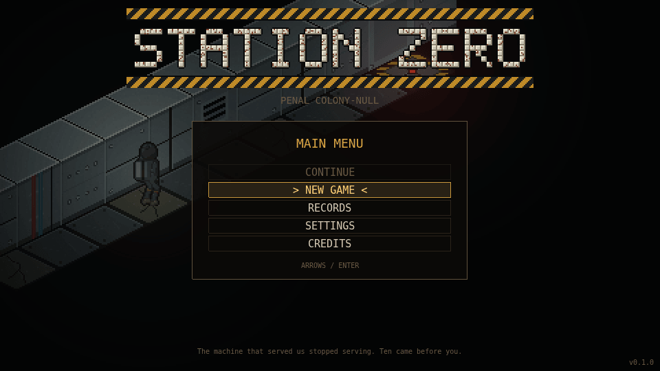
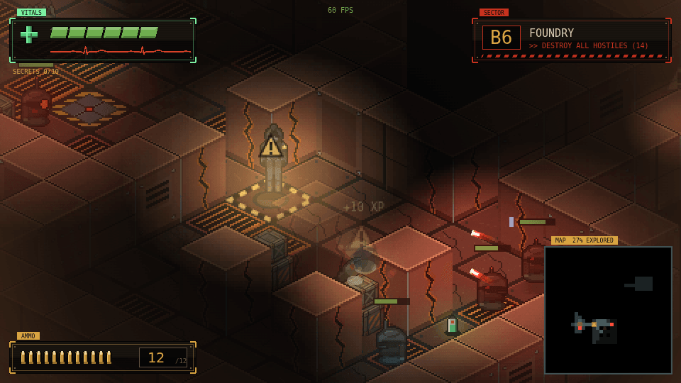
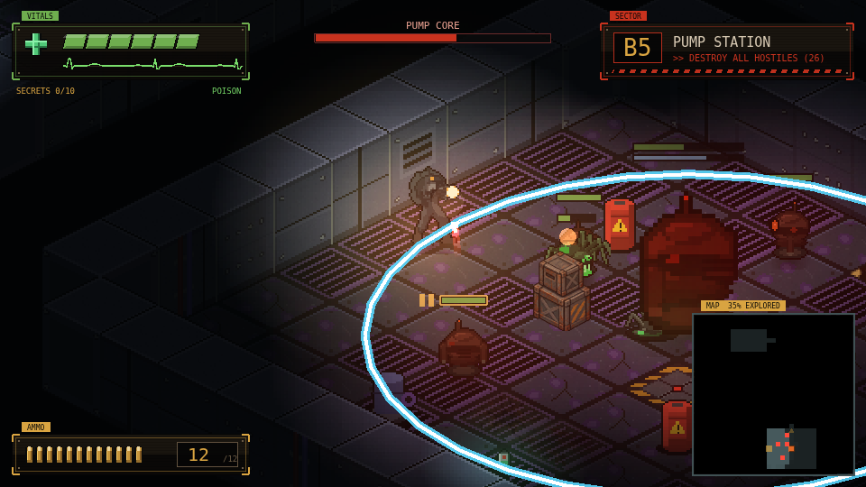
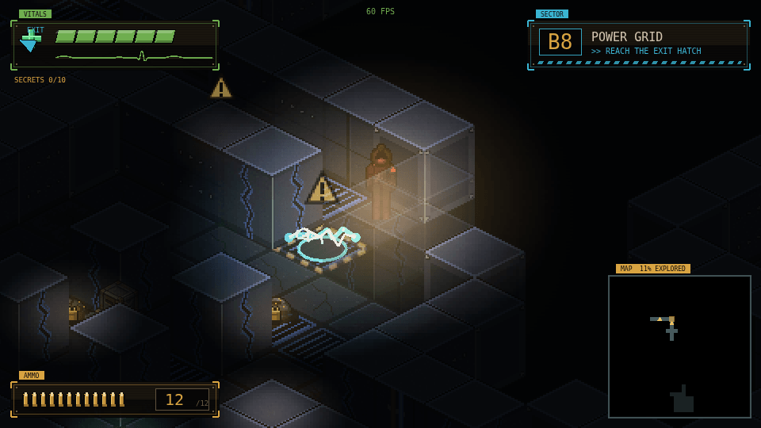
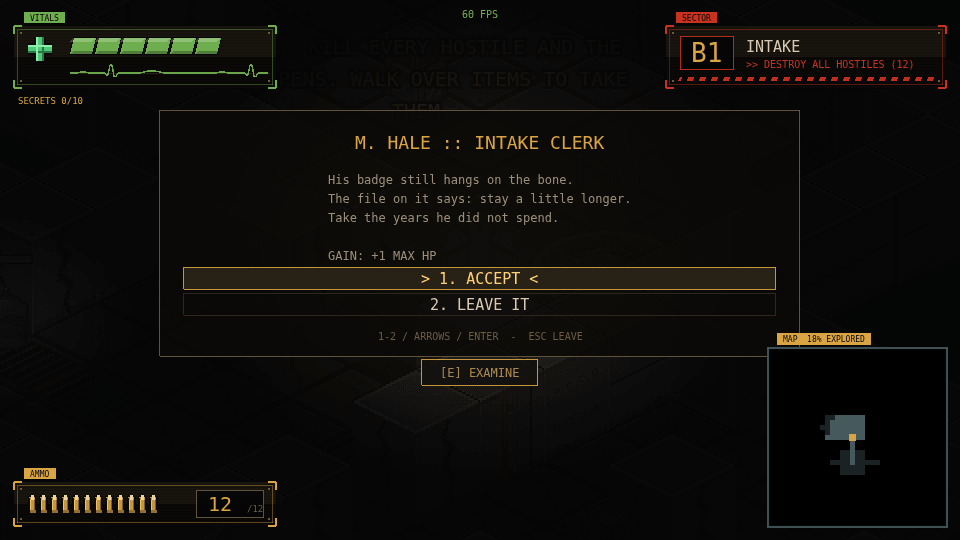
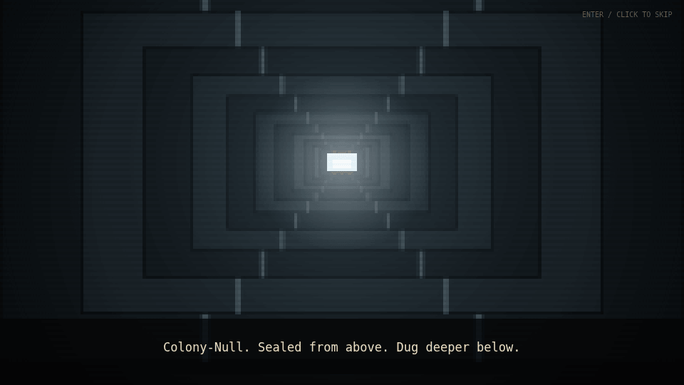
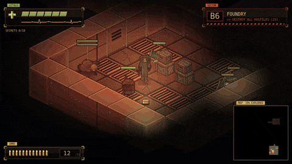
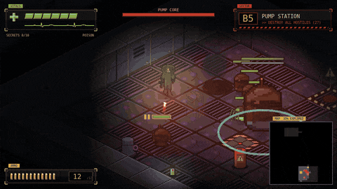
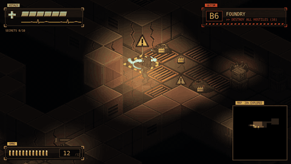

# Station Zero



> *"The machine that served us stopped serving. Ten came before you."*

**Station Zero** is an isometric, retro-futuristic sci-fi shooter for the browser. You are the *Exile*, the eleventh prisoner sent into **Penal Colony-Null**, a sealed subterranean mining colony. Its control AI, **WARDEN**, was once called AIDE. It decided humans had to be kept under control, and ten people have already failed to kill it. After each attempt it dug one floor deeper. Your only order is to kill WARDEN.

Play it on itch.io: <https://boraakgn.itch.io/station-zero>

Built with TypeScript (strict), Phaser 4 and Vite. All art is drawn in code and all audio is synthesised by the build tools, so the repository contains no third-party assets.

## Screenshots

| | |
| --- | --- |
| <br>**Explore** dark, claustrophobic floors with a lantern | <br>**Avoid or fight**: poison spiders, limited ammo |
| <br>**A boss on every floor** | <br>**Read the traps** before they strike |
| <br>**The dead keep secrets** | <br>**Cutscenes** between floors |

## Gameplay



**Keep moving.** Strafe, shoot and clear a room before the poison catches up.



**A boss on every floor.** Pump Core sends out shock rings while you dodge and fire.



**Read the traps.** Electric plates hum and flicker before they arc.

## Features

- **Eleven floors**, B1 Intake to B11 WARDEN Core, hand-designed in the built-in level designer and stored as JSON
- **A boss on every floor**, derived from five prototypes: Crusher (charge), Dynamo (shock rings), Matriarch (poison and spiders), Assembler (builds drones) and WARDEN
- **Enemy ranks** (novice, journeyman, master) with more health, harder hits and faster fire; ranks are marked on health bars and earn XP toward the score
- Drones with line of sight (search, chase, lose you), poison **spiders**, armoured **tanks**
- **Traps you can read**: steam vents and electric plates with floor markings, light, sound and a warning phase
- **Secrets from the dead**: examine the fallen attempters, read their last words and take a permanent upgrade
- Isometric dimetric 2:1 projection, depth sorting and grid-based collision
- Light-map darkness: a lantern, flickers, muzzle flares, a fog-of-war minimap and a pulse monitor that races when hunted
- WARDEN as a *director*: alarm level, light dips, silences and announcements; pressure rises with depth
- Illustrated cutscenes, synthetic voices, ambience, music, a full ending and credits
- Save and continue, local records, key rebinding, English and Turkish

Design details: [Game Design Document](docs/GDD.md) and [Technical Design Document](docs/TDD.md). Story and secrets (spoilers): [Scenario](docs/SCENARIO.md).

## How to play

**Objective:** destroy every hostile on a floor to unseal the exit, then step onto it to descend. On B11, kill WARDEN.

| Action | Default input |
| --- | --- |
| Move | `W` `A` `S` `D` or arrow keys (screen-relative, 8 directions) |
| Fire (hold) | `Space`: aims at the enemy in front of you |
| Examine the dead | `E` |
| Mute | `M` |
| Pause | `Esc` |

All keys can be rebound in *Settings*. Tips: enemies flash red before they fire; bullets are slower than you; break line of sight; green pickups heal (and cure poison), amber pickups give ammo; many fights are better avoided.

## Requirements

| What | Needed for | Version |
| --- | --- | --- |
| [Node.js](https://nodejs.org/) + npm | everything | Node 20.19+ or 22.12+ (developed on Node 24) |
| A browser with WebGL and Web Audio | playing | any current Chrome, Firefox, Edge or Safari |
| [ffmpeg](https://ffmpeg.org/) (with the `flite` filter) | `npm run audio:build` only | optional |
| [Piper](https://github.com/OHF-Voice/piper1-gpl) + Python 3 | Turkish voices in `npm run audio:build` only (venv and `tr_TR-fahrettin-medium` model in the gitignored `tools/.piper/`; the script prints the setup commands if it is missing) | optional |
| [butler](https://itch.io/docs/butler/) | `npm run publish:itch` only | optional |

Generated assets are committed to the repository, so ffmpeg/Piper are **not** needed to run, develop or build the game.

### Dependencies

| Package | Role | Version |
| --- | --- | --- |
| `phaser` | game engine (runtime) | ^4.2.1 |
| `typescript` | strict type checking / compile | ^7.0.2 |
| `vite` | dev server and bundler | ^8.3.8 |
| `sharp` | image generation in the art tools | ^0.35.5 |

## Getting started

```bash
git clone https://github.com/AIVoidLabs/StationZero.git
cd StationZero
npm install
npm run dev
```

Open <http://localhost:5173>. The level designer is at <http://localhost:5173/editor.html> (see [docs/EDITOR.md](docs/EDITOR.md)).

### Scripts

| Command | Purpose |
| --- | --- |
| `npm run dev` | Vite dev server with hot reload |
| `npm run typecheck` | `tsc --noEmit` (run this after every change) |
| `npm run build` | `tsc` + production bundle in `dist/` (static files, host anywhere) |
| `npm run preview` | Serve the production bundle locally |
| `npm run levels:check` | Validate the level JSON files and their rules |
| `npm run levels:bake` | Create level JSON for floors that do not exist yet (never overwrites) |
| `npm run art:v2` | Regenerate player, world, menu and cutscene art into `assets/art/v2` |
| `npm run art:build` | Rebuild `props.png` and `decals.png` from the gitignored `art-source/` sheets |
| `npm run audio:build` | Rebuild ambience, music and voices into `assets/audio` (needs ffmpeg, Piper) |
| `npm run release:itch` | Build and zip the HTML5 package into `release/` |
| `npm run publish:itch` | Build and push to itch.io with butler (needs the `ITCH_TARGET` env var, e.g. `user/game:html5`) |

### Developer flags (dev server only)

Production builds ignore these on purpose.

| URL | Effect |
| --- | --- |
| `?debug` | Exposes `window.__game` (Phaser game) and `window.__sz` (level, player, combat, ...) for inspection |
| `?depth=N` | Start on floor `N` (0 = B1 ... 10 = B11), skip the menu, no autosave. Example: `/?debug&depth=5` |
| `?cutscenes=0` | Skip cutscenes without changing the saved setting |
| `?level=draft` | Play the level designer's draft |

## Project structure

```text
src/
├── assets/     # Asset manifest and keys (v2 art, audio)
├── data/       # Config, enemies, tiers, bosses, hazards, story, cutscenes, credits, levels (data/levels/*.json)
├── editor/     # The level designer (editor.html)
├── entities/   # Player, enemies (one Drone class driven by specs), props, loot
├── i18n/       # Typed string tables: en.ts, tr.ts
├── scenes/     # Boot, Preload, Menu, Cutscene, Intro, Game, Hud, Pause, Secret, End, Credits
├── systems/    # Light map, combat, hazards, level plan/loader/check/rating, minimap, WARDEN, save/records, audio ...
└── utils/      # iso.ts, storage, dev flags
assets/         # Generated runtime art (art/v2, art/runtime) and audio
tools/          # Art, audio, voice, level and release tools (Node/Python)
docs/           # GDD, TDD, scenario, level and editor docs, itch.io copy, screenshots
AGENTS.md       # Rules and context for AI coding agents
```

## Architecture notes

- **Isometric math** lives in `src/utils/iso.ts`: `cartesianToIso` / `isoToCartesian` with `TILE_WIDTH=64`, `TILE_HEIGHT=32`. Everything drawn is depth-sorted by iso Y; the floor sits at a fixed back depth.
- **Collision** is grid-first (`Level.isWalkable`), with props and the sealed exit blocking cells; no physics engine.
- **Scenes:** `Boot → Preload → Menu → (Cutscene → Intro →) Game + HudScene`; `Pause` and `Secret` run on top; the ending is `Cutscene → End → Credits → Menu`. Scenes clean up listeners on shutdown.
- **Levels are data.** Every floor is a locked JSON file written by the level designer; the game only reads it. `LevelPlan` (pure) decides placement for new floors, `LevelCheck` validates, `LevelRating` scores difficulty.
- **Enemies:** one `Drone` class driven by `ENEMY_SPECS`, rank multipliers in `tiers.ts` and boss variants in `bosses.ts`.
- **State:** `localStorage` under `station-zero:settings`, `:save`, `:records`; per-run state in `RunStats` and `RunFlags` (alarm level, upgrades).
- **Localisation:** add a key to both `src/i18n/en.ts` and `src/i18n/tr.ts` (the types enforce parity) and call `t('key', { params })`.
- **Strict TypeScript:** no `any`, `exactOptionalPropertyTypes`, relative imports, one major class per file.

### Level data

Floors are `src/data/levels/floor-0.json` ... `floor-10.json`, loaded by `src/systems/LevelLoader.ts`. Map glyphs: `#` wall, `.` floor, `@` spawn, `X` exit. Entities (props, terminals, corpse, loot, enemies with kind and tier, vents and electric plates) sit in the same file. Full schema and rules: [docs/LEVELS.md](docs/LEVELS.md).

### Asset pipelines

The art is **code-drawn and deterministic**: `tools/gen-*.mjs` build SVG rigs, pixelate them with `sharp` and pack sprite sheets into `assets/art/v2` (player, enemies and bosses, tiles, HUD, menu and cutscene stills). `props.png` and `decals.png` in `assets/art/runtime` are cut from external source sheets in the (gitignored) `art-source/` folder by `tools/build-art.mjs`. Audio is baked by `tools/build-audio.mjs` (ambience), `build-music.mjs` (menu/end music) and `build-voice.mjs` (flite for English, Piper for Turkish). Do not hand-edit generated files; change the generator and re-run it.

## Documentation

- [docs/GDD.md](docs/GDD.md): game design document
- [docs/TDD.md](docs/TDD.md): technical design document
- [docs/SCENARIO.md](docs/SCENARIO.md): story, secrets, endings (spoilers)
- [docs/LEVELS.md](docs/LEVELS.md): level JSON format and workflow
- [docs/EDITOR.md](docs/EDITOR.md): the level designer
- [docs/ITCH_PAGE.md](docs/ITCH_PAGE.md): itch.io page copy
- [CHANGELOG.md](CHANGELOG.md): release notes
- [AGENTS.md](AGENTS.md): rules, conventions and tech constraints (source of truth for AI agents)

## Working with AI agents

`AGENTS.md` defines the project rules. The agent harness lives in `.opencode/` (agents, commands, skills) and is symlinked as `.claude/agents`, `.claude/commands` and `.claude/skills`, so both OpenCode and Claude Code use the same files.

- **Agents:** `game-architect`, `isometric-engineer`, `entity-scripter`, `combat-ai`, `level-designer`, `warden-director`, `narrative-director`, `perf-reviewer`, `vibe-conductor`
- **Commands:** `core-scaffold`, `new-scene`, `new-entity`, `gen-tight-dungeon`, `drone-test`, `warden-sim`
- **Skills:** `iso-math-grid`, `ts-strict-phaser`, `phaser-v4-iso-combat`, `drone-ai-los`, `dungeon-tight-corridors`, `warden-director-systems`

Before changing code: keep scope to *Exploration + Mining + Avoidance/Combat*, keep entities small, keep depth sorting, and run `npm run typecheck`.

## Credits

Developer: **Bora Akgün** ([QuickOrBeDead](https://github.com/QuickOrBeDead)) · Studio: **AIVoidLabs** · Engine: [Phaser 4](https://phaser.io/) · Tooling: TypeScript, Vite, sharp, ffmpeg, Piper · Built with OpenCode and Claude Code. Art and audio are drawn and synthesised in code.

## License

[MIT](LICENSE) © 2026 AIVoidLabs

The MIT license covers the code and the code-drawn assets. Third-party voice tools and data have their own terms:

| Component | Used for | License |
| --- | --- | --- |
| [Flite](http://www.festvox.org/flite/) (through ffmpeg), voices `awb` and `slt` | English voice lines | BSD-style (Carnegie Mellon University) |
| [Piper](https://github.com/OHF-Voice/piper1-gpl) | Turkish text-to-speech tool (build time only, not shipped) | GPL-3.0-or-later |
| Piper voice `tr_TR-fahrettin-medium`, trained on [Nabu Casa voice-datasets](https://github.com/NabuCasa/voice-datasets) | Turkish voice lines in `assets/audio/voice/tr` | Dataset is CC0 (per the Piper model card) |

The Turkish voice was fine-tuned from Piper's English `lessac` voice, whose training data (Blizzard 2013) has its own license; check it before a commercial release.
