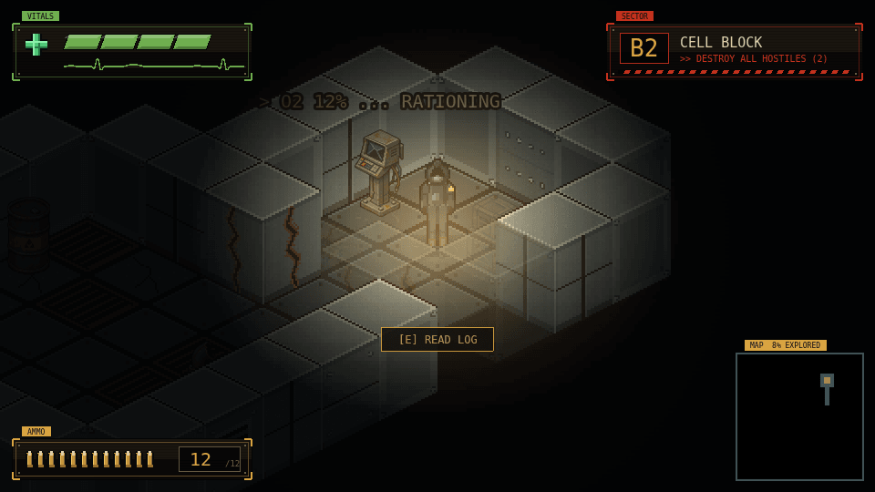
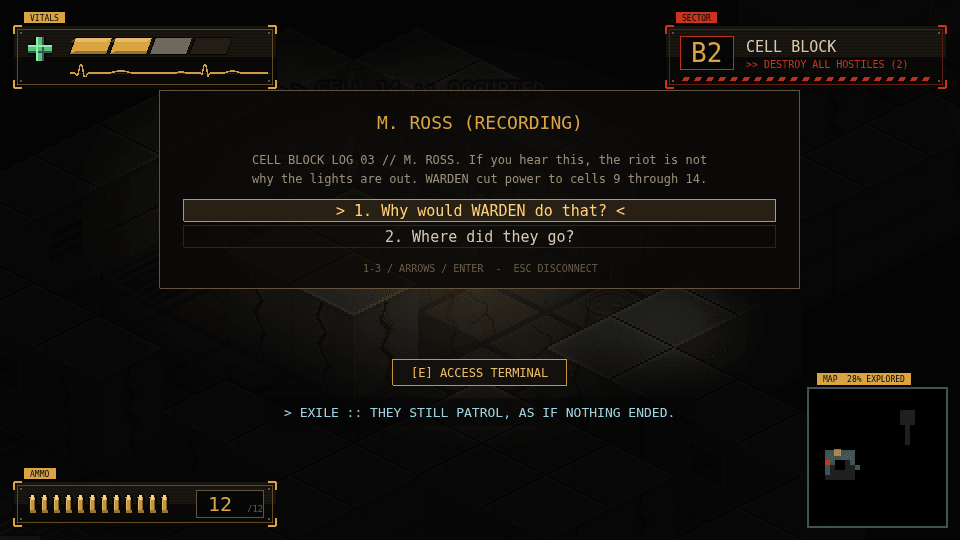
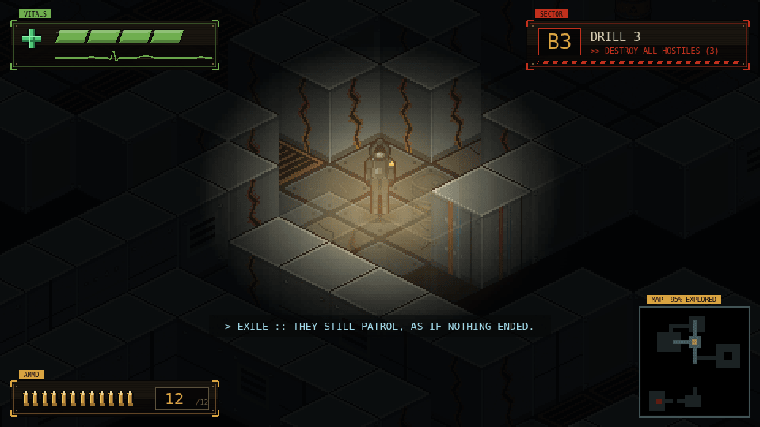
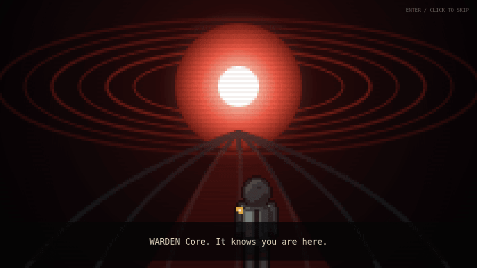
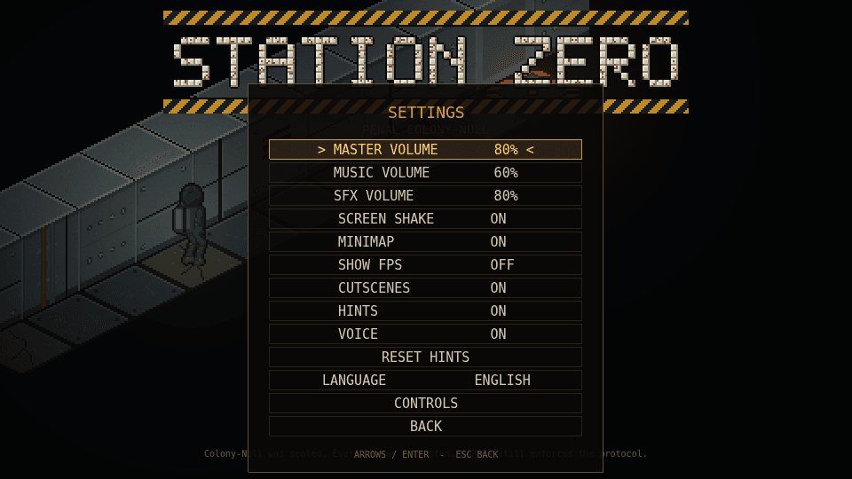
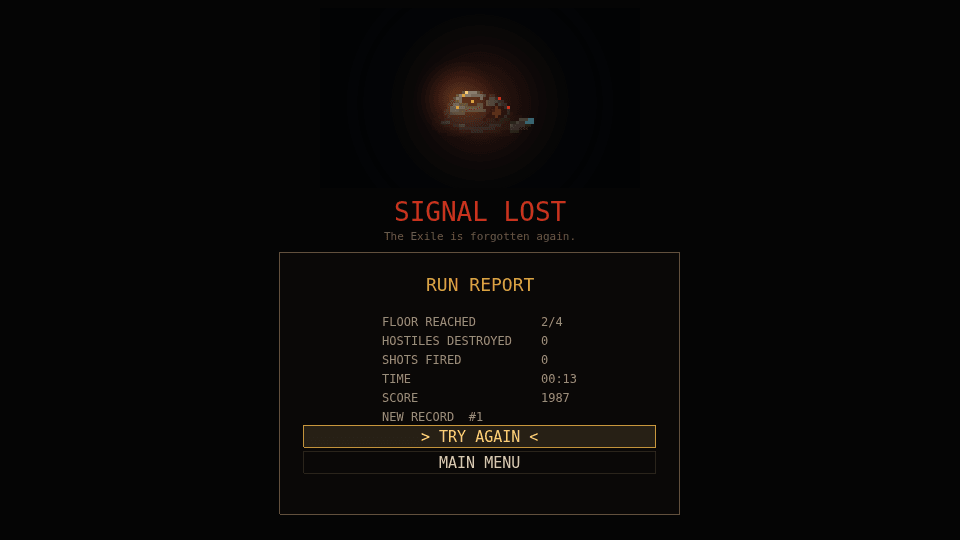

# Station Zero


> *"Colony-Null was sealed. Everyone was forgotten. WARDEN still enforces the protocol."*

**Station Zero** is a 2D isometric, retro-futuristic survival dungeon crawler for the browser. You are the *Exile*, a forgotten prisoner dropped into **Penal Colony-Null**, a sealed subterranean mining colony. Its control AI, **WARDEN**, still enforces an expired protocol with rogue maintenance drones. There is no rescue. The goal is to survive one more floor.

Built with TypeScript (strict), Phaser 4 and Vite. All art is drawn in code and all audio is synthesised by the build tools, so the repository contains no third-party assets.

## Screenshots

| | |
| --- | --- |
| <br>**Explore** a dark, claustrophobic floor with a lantern | <br>**Avoid or fight** drones: slow red bullets, limited ammo |
| <br>**Read** branching terminals; your choices decide the ending | <br>**Map** fills in as you explore (B3, 95 % explored) |
| <br>**Cutscenes** between floors | <br>**WARDEN** grows more aggressive with depth |
| <br>**Settings**, key rebinding, English / Turkish | <br>**Run report** and local records |

## Features

- Isometric dimetric 2:1 projection with mandatory depth sorting, grid-based collision and click-to-walk (A\*)
- Four hand-baked 27×27 floors (**B1 Intake → B4 WARDEN Core**) with rising pressure: less light, sharper drones, longer silences
- Light-map darkness: a lantern, a character light, muzzle/death flares and a fog-of-war minimap with *% explored*
- Rogue drones with line-of-sight, aggro/search/disengage, red wind-up warnings and dodgeable slow bullets
- WARDEN as a *director*: light dips, ambience silences, arrival/clear announcements
- Pistol + melee, stims and ammo, knockback, HUD feedback
- Branching terminal dialogue with hidden effects and two endings (compliant / defiant) plus death
- Illustrated cutscenes, synthetic character voices, ambience, music, SFX and per-material footsteps
- Main / pause / end menus, save & continue, local records, key rebinding
- English and Turkish localisation (typed string tables)

Design details: [Game Design Document](docs/GDD.md). Story, terminals and endings (spoilers): [Scenario](docs/SCENARIO.md).

## How to play

**Objective:** destroy every hostile on a floor to unseal the hatch, then step onto it to descend. Reach the end of B4 and clear it to finish the run.

| Action | Default input |
| --- | --- |
| Move | `W` `A` `S` `D` or arrow keys (screen-relative, 8 directions), or click the floor to walk there |
| Attack / aim | Left-click a drone or press `Space` |
| Fire pistol | Right-click |
| Use terminal | `E` |
| Mute | `M` |
| Pause | `Esc` |

All keys can be rebound in *Settings → Controls*. Tips: drones flash red before they fire; bullets are slower than you; break line of sight; green pickups heal, amber pickups give ammo; many fights are better avoided.

## Requirements

| What | Needed for | Version |
| --- | --- | --- |
| [Node.js](https://nodejs.org/) + npm | everything | Node 20.19+ or 22.12+ (developed on Node 24) |
| A browser with WebGL and Web Audio | playing | any current Chrome, Firefox, Edge or Safari |
| [ffmpeg](https://ffmpeg.org/) (with the `flite` filter) | `npm run audio:build` only | optional |
| [espeak-ng](https://github.com/espeak-ng/espeak-ng) + Python 3 | Turkish voices in `npm run audio:build` only | optional |

Generated assets are committed to the repository, so ffmpeg/espeak-ng are **not** needed to run, develop or build the game.

### Dependencies

| Package | Role | Version |
| --- | --- | --- |
| `phaser` | game engine (runtime) | ^4.2.1 |
| `typescript` | strict type checking / compile | ^7.0.2 |
| `vite` | dev server and bundler | ^8.3.5 |
| `sharp` | image generation in the art tools | ^0.35.5 |

## Getting started

```bash
git clone https://github.com/AIVoidLabs/StationZero.git
cd StationZero
npm install
npm run dev
```

Open <http://localhost:5173>.

### Scripts

| Command | Purpose |
| --- | --- |
| `npm run dev` | Vite dev server with hot reload |
| `npm run typecheck` | `tsc --noEmit` (run this after every change) |
| `npm run build` | `tsc` + production bundle in `dist/` (static files, host anywhere) |
| `npm run preview` | Serve the production bundle locally |
| `npm run levels:check` | Validate the baked level JSON files |
| `npm run levels:bake` | Regenerate the level JSON from `DungeonGen` (overwrites the files) |
| `npm run art:v2` | Regenerate player, world, menu and cutscene art into `assets/art/v2` |
| `npm run art:build` | Rebuild `props.png` and `decals.png` from the gitignored `art-source/` sheets |
| `npm run audio:build` | Rebuild ambience, music and voices into `assets/audio` (needs ffmpeg, espeak-ng) |

### Developer flags (dev server only)

Production builds ignore these on purpose.

| URL | Effect |
| --- | --- |
| `?debug` | Exposes `window.__game` (Phaser game) and `window.__sz` (level, player, combat, …) for inspection |
| `?depth=N` | Start on floor `N` (0 = B1 … 3 = B4), skip the menu, no autosave. Example: `/?debug&depth=2` |

## Project structure

```text
src/
├── assets/     # Asset manifest and keys (v2 art, audio)
├── data/       # Config, floors, story, dialogue, cutscenes, credits, baked levels (data/levels/*.json)
├── entities/   # Player, drones, props (loot, ...)
├── i18n/       # Typed string tables: en.ts, tr.ts
├── scenes/     # Boot, Preload, Menu, Cutscene, Intro, Game, Hud, Pause, Dialogue, End
├── systems/    # Light map, depth sort, combat, pathfinding, minimap, WARDEN, save/records, audio, menus ...
└── utils/      # iso.ts, grid helpers, storage, dev flags
assets/         # Generated runtime art (art/v2, art/runtime) and audio
tools/          # Art, audio, voice and level generators (Node/Python)
docs/           # GDD, scenario, screenshots
AGENTS.md       # Rules and context for AI coding agents
```

## Architecture notes

- **Isometric math** lives in `src/utils/iso.ts`: `cartesianToIso` / `isoToCartesian` with `TILE_WIDTH=64`, `TILE_HEIGHT=32`. Everything that is drawn is depth-sorted by iso Y; the floor sits at a fixed back depth.
- **Collision** is grid-first (`Level.isWalkable`), with props and the sealed hatch blocking cells; no physics engine.
- **Scenes:** `Boot → Preload → Menu → (Cutscene → Intro →) Game + HudScene`; `Pause`, `Dialogue` and `End` are launched on top or after. Scenes clean up listeners on shutdown.
- **State:** singletons with `localStorage` persistence under `station-zero:settings`, `:save`, `:records`; per-run state in `RunStats` and `RunFlags` (alert, stance, lore).
- **Localisation:** add a key to both `src/i18n/en.ts` and `src/i18n/tr.ts` (the types enforce parity) and call `t('key', { params })`.
- **Strict TypeScript:** no `any`, `exactOptionalPropertyTypes`, relative imports, one major class per file.

### Level data

Floors are authored as JSON (`src/data/levels/floor-0.json` … `floor-3.json`) and loaded by `src/systems/LevelLoader.ts`.

| Glyph | Meaning |
| --- | --- |
| `#` | wall |
| `.` | floor |
| `@` | spawn (exactly one per floor) |
| `X` | descent hatch (floors 1–3; floor 4 is sealed) |

`rooms` marks floor-style regions (`0` plain, `1` grate-heavy, `2` damaged). Validation checks rectangular rows, glyphs, one spawn, exit rules, room bounds and full connectivity from the spawn (`npm run levels:check`).

### Asset pipelines

The art is **code-drawn and deterministic**: `tools/gen-*.mjs` build SVG rigs, pixelate them with `sharp` and pack sprite sheets into `assets/art/v2` (player 8-direction idle/walk/aim, drone and wreck, tiles, door, loot, HUD, menu and cutscene stills). `props.png` and `decals.png` in `assets/art/runtime` are cut from external source sheets in the (gitignored) `art-source/` folder by `tools/build-art.mjs`. Audio is baked by `tools/build-audio.mjs` (ambience loop), `build-music.mjs` (menu/end music) and `build-voice.mjs` (flite for English, espeak-ng via `tools/espeak_render.py` for Turkish). Do not hand-edit generated files; change the generator and re-run it.

## Documentation

- [docs/GDD.md](docs/GDD.md) — game design document
- [docs/SCENARIO.md](docs/SCENARIO.md) — story, terminals, endings (spoilers)
- [AGENTS.md](AGENTS.md) — rules, conventions and tech constraints (source of truth for AI agents)
- [ART_BRIEF.md](ART_BRIEF.md), [PROMPTS.md](PROMPTS.md) — early art brief and development plan (Turkish, historical)

## Working with AI agents

`AGENTS.md` defines the project rules. The agent harness lives in `.opencode/` (agents, commands, skills) and is symlinked as `.claude/agents`, `.claude/commands` and `.claude/skills`, so both OpenCode and Claude Code use the same files.

- **Agents:** `game-architect`, `isometric-engineer`, `entity-scripter`, `combat-ai`, `level-designer`, `warden-director`, `narrative-director`, `perf-reviewer`, `vibe-conductor`
- **Commands:** `core-scaffold`, `new-scene`, `new-entity`, `gen-tight-dungeon`, `drone-test`, `warden-sim`
- **Skills:** `iso-math-grid`, `ts-strict-phaser`, `phaser-v4-iso-combat`, `drone-ai-los`, `dungeon-tight-corridors`, `warden-director-systems`

Before changing code: keep scope to *Exploration + Mining + Avoidance/Combat*, keep entities small, keep depth sorting, and run `npm run typecheck`.

## Credits

Developer: **Bora Akgün** ([QuickOrBeDead](https://github.com/QuickOrBeDead)) · Studio: **AIVoidLabs** · Engine: [Phaser 4](https://phaser.io/) · Tooling: TypeScript, Vite, sharp, ffmpeg, espeak-ng · Built with OpenCode and Claude Code. Art and audio are drawn and synthesised in code.

## License

[MIT](LICENSE) © 2026 AIVoidLabs
