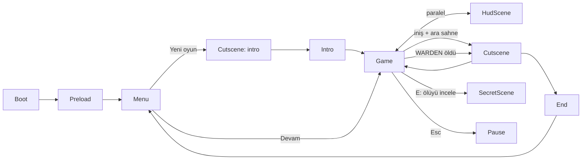
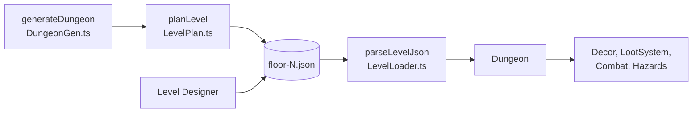
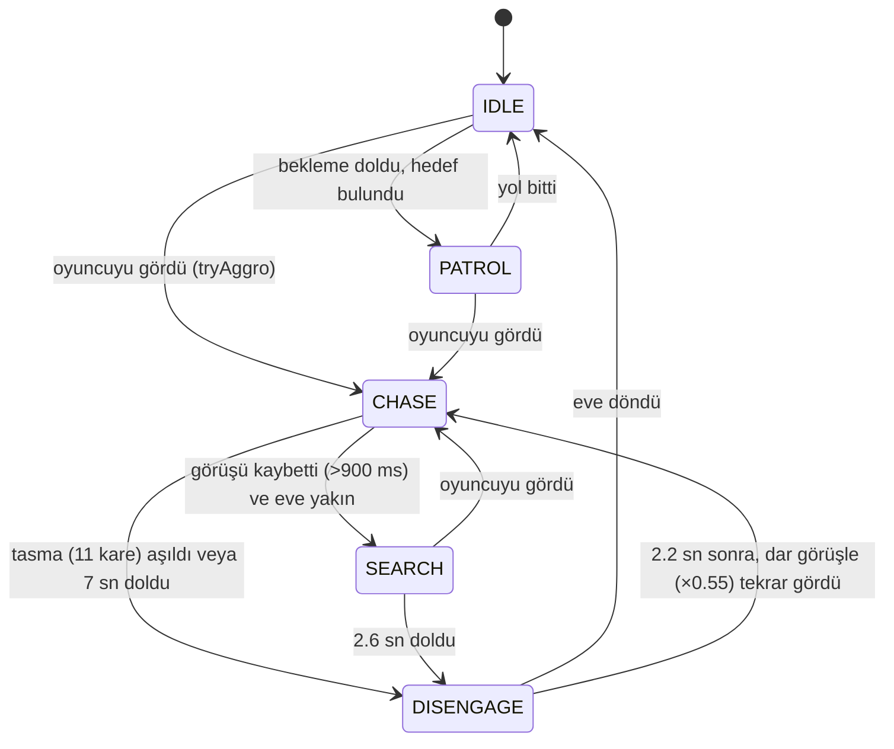

# Station Zero - Teknik Tasarım Dokümanı (TDD)

Bu belge oyunun **nasıl kodlandığını** anlatır. Oyunun ne olduğunu ve neden öyle tasarlandığını anlatan belgeler: [GDD.md](GDD.md) (oyun tasarımı), [SCENARIO.md](SCENARIO.md) (hikâye), [LEVELS.md](LEVELS.md) (kat JSON şeması), [EDITOR.md](EDITOR.md) (level designer kullanımı). Bu belge onların tekrarı değildir; sistemlerin iç işleyişini, veri yapılarını ve algoritmaları anlatır.

Kod, dosya ve sistem adları İngilizce bırakılmıştır. Dosya yolları depo köküne göredir. Sayısal değerler kodla birebir eşleşir; kod değişince bu belge de güncellenmelidir.

## İçindekiler

1. [Giriş ve kapsam](#1-giriş-ve-kapsam): amaç, teknoloji yığını, tasarım kısıtları, komutlar
2. [Mimari genel bakış](#2-mimari-genel-bakış): dizin yapısı, sahne grafiği, `Game.create`/`update`, yaşam döngüsü, durum katmanları
3. [İzometrik temel](#3-i̇zometrik-temel): projeksiyon, derinlik sıralama, duvar/şeffaflık, ızgara çarpışması, kamera
4. [Seviye sistemi](#4-seviye-sistemi): JSON modeli, üretici, planlayıcı, yükleyici/doğrulama, araçlar, tema
5. [Oyuncu](#5-oyuncu): hareket, can/mermi, silah, mermiler, fener ve karanlık
6. [Düşmanlar](#6-düşmanlar): tür tablosu, durum makinesi, algılama, saldırı, zırh, boss, `Combat`, A\*
7. [Çevre ve tuzaklar](#7-çevre-ve-tuzaklar): buhar, patlayan varil, siper/prop, boss-çevre kuralları
8. [Mekanikler](#8-mekanikler): keşif, loot, çıkış kapısı, sırlar, ölüler, ipuçları, alarm, zorluk, derinlik baskısı, ölüm/yeniden deneme, bitiş
9. [WARDEN atmosferi](#9-warden-atmosferi): nabız/sessizlik yönetmeni, anons akışı, hikâye verisi
10. [Arayüz](#10-arayüz): HUD, MenuKit, menüler, ara sahneler, yerelleştirme
11. [Ses](#11-ses): `Sfx`, ambiyans, müzik, `Voice`, üretim hattı
12. [Görsel üretim hattı](#12-görsel-üretim-hattı): kodla üretilen sanat, tile sayfaları, manifest
13. [Kalıcılık](#13-kalıcılık): ayarlar, kayıt, rekorlar
14. [Level Designer](#14-level-designer-editör): mimari, model, araçlar, doğrulama, üretici/kilit/oyna
15. [Test ve kalite araçları](#15-test-ve-kalite-araçları): statik denetim, botlar, hata ayıklama kancaları, ölçümler
16. [Performans ve sağlamlık](#16-performans-ve-sağlamlık): çizim maliyeti, bellek, determinizm
17. [Bilinen sorunlar ve genişletme noktaları](#17-bilinen-sorunlar-ve-genişletme-noktaları)
- Ekler: [A. Dosya haritası](#ek-a-dosya-haritası) · [B. Sabitler](#ek-b-sabitler-özet) · [C. Durum makineleri](#ek-c-durum-makineleri) · [D. Sözlük](#ek-d-sözlük)

---

## 1. Giriş ve kapsam

### 1.1 Amaç ve okuyucu
Belge, projeye yeni katılan bir geliştiricinin (ya da bir yapay zekâ ajanının) kodu okumadan önce sistemlerin haritasını çıkarabilmesi için yazıldı. Her sistem aynı şablonla anlatılır: **Amaç → Dosyalar → Veri yapısı → Algoritma → Kritik kod → Tasarım kararı ve dikkat edilecekler.**

### 1.2 Teknoloji yığını
| Katman | Seçim |
| --- | --- |
| Dil | TypeScript (strict). `any` yasak, açık tipler ve arayüzler. |
| Oyun motoru | Phaser 4 (WebGL/Canvas), `pixelArt: true`, `roundPixels: true` |
| Derleme | Vite (`npm run dev`, `npm run build` = `tsc && vite build`) |
| Görüntü | 2D izometrik (dimetrik 2:1), mantıksal çözünürlük 960×540, FIT ölçekleme |
| Üretim araçları | Node betikleri (`tools/*.mjs`), `sharp` (resim), ffmpeg + flite/espeak (ses) |
| Kalıcılık | Tarayıcı `localStorage` (ayarlar, kayıt, rekorlar) |

Oyun içinde harici sanat/ses dosyası zorunluluğu azdır: tile ve sprite'lar `tools/gen-*.mjs` ile **kodla üretilir** (bkz. 12), sesler büyük oranda WebAudio ile **sentezlenir** (bkz. 11).

### 1.3 Tasarım kısıtları (kodu şekillendiren kararlar)
- **Minimal kapsam:** yalnızca keşif + madencilik (toplama) + kaçınma/savaş. Envanter, XP, el yapımı yoktur.
- **Izgara tabanlı çarpışma:** dar koridorlarda fizik motoru yerine `Level.isWalkable` ile hücre kontrolü (bkz. 3.4).
- **Derinlik sıralama zorunlu:** her çizilen nesnenin `depth` değeri izometrik `y`'sinden gelir (bkz. 3.2).
- **Klavye-yalnız oyun:** fare ile yürüme/ateş kaldırıldı. Menüler fareyle de çalışır.
- **Deterministik içerik:** katlar ve yerleşimler tohumlu RNG ile üretilir, sonuç JSON'a yazılır (bkz. 4 ve 16.3).
- **Strict null / tip güvenliği:** `noUnusedLocals` açık olduğu için kullanılmayan her içe aktarma derleme hatasıdır.

### 1.4 Komutlar ve geliştirme akışı
```bash
npm run dev            # Vite dev sunucusu, http://localhost:5173
npm run typecheck      # tsc --noEmit
npm run build          # tsc + vite build (editör pakete girmez)
npm run levels:bake    # kat JSON'larını yeniden üret (kilitli katlar atlanır)
npm run levels:check   # JSON şeması + kurallar
npm run art:v2         # kodla üretilen sanatı yeniden üret
node tools/build-voice.mjs   # ses üretimi (ffmpeg gerekir)
```
Geliştirme sayfaları: oyun `/`, level designer `/editor.html`. Hata ayıklama parametreleri 15.3'te.

---

## 2. Mimari genel bakış

### 2.1 Dizin yapısı ve modül sınırları
```text
src/
├── assets/        manifest.ts: varlık anahtarları ve yükleme listesi
├── data/          salt-okunur veri: config, enemies, difficulty, hazards, secrets, story...
├── entities/      Entity tabanı, Player, enemies/Drone, props/LootPickup
├── scenes/        Phaser sahneleri: Boot, Preload, Menu, Intro, Cutscene, Game, Hud, Pause, Secret, End
├── systems/       oyun sistemleri (Combat, Hazards, LootSystem, DungeonGen, LevelPlan, ...)
├── editor/        level designer (ayrı giriş: editor.html)
├── i18n/          en.ts, tr.ts, index.ts (t(), StringKey)
└── utils/         saf yardımcılar: iso, grid, random, devflags, storage
tools/             derleme/üretim/test betikleri (Node)
```
Kurallar: `data/` ve `utils/` hiçbir şeye bağımlı değildir (saf). `systems/` sahne nesnesini kurucuda alır ama sahnelere bağımlı değildir. `scenes/` sistemleri oluşturur ve bağlar. Göreli içe aktarma kullanılır.

### 2.2 Sahne grafiği
Phaser sahneleri `src/main.ts` içinde sırayla kayıtlıdır: `Boot, Preload, Menu, Cutscene, Intro, Game, HudScene, Pause, SecretScene, End`.


- `Boot` boştur, `Preload`'a geçer. `Preload` `ASSETS` listesini yükler, `ensureArt` (yedek dokular) ve `registerTilesV2` (tile çerçeveleri) çağırır, sonra `Menu`'ye (dev modunda `?depth=N` ile doğrudan `Game`'e) geçer.
- `HudScene` `Game` ile **birlikte çalışan paralel** bir sahnedir (`scene.launch`). HUD, `Game.hudState` getter'ından her karede okur. Böylece oyun nesneleri ile arayüz ayrıdır, kamera zoom'u HUD'u etkilemez.
- `Secret` ve `Pause` açılırken `Game` ve `HudScene` **duraklatılır** (`scene.pause`), kapanınca devam ettirilir.

### 2.3 `Game.create` oluşturma sırası
Sıra önemlidir, çünkü sonraki sistemler öncekilerin durumunu (özellikle `Level.blockCell`) okur ([Game.ts](../src/scenes/Game.ts), `create`):

1. `loadDungeon(floor)` → `Dungeon` (JSON'dan, bkz. 4.4). `new Level(dungeon)` ve `level.render(this)`.
2. `Decor`: JSON'daki prop ve terminalleri **çizer ve ilgili hücreleri bloklar**; ölü ve hale; süs decal'leri.
3. `runFlags.alert = 0` (her kat sakin başlar), `Player`, kat giriş durumunun (`FloorEntry`) kaydı.
4. `DepthManager(floor)` (derinlik baskısı), `LootSystem`, `Combat` (düşmanlar JSON'dan), `Hazards` (buhar delikleri), `Barrels`.
5. `DescentGate` ve çıkış hücresini bloklama.
6. `Lantern`, `LightMap` (karanlık), `WardenAtmosphere`, `Ambience`, `LogFeed`, `Occlusion`, `Exploration`.
7. Kayıt (`saveGame.save`), `PlayerCombat`, HUD sahnesinin başlatılması, kamera.

Değer: `Player` yaratıldığında `Level` zaten props tarafından bloklanmıştır; düşmanlar spawn'ı JSON'dan alır, bu yüzden aralarında RNG bağımlılığı yoktur (bkz. 4.3).

### 2.4 `Game.update` döngüsü
Her kare, `delta` ms ile (Phaser'ın hesapladığı). Sıra:

```text
duraklatma/mute tuşları → runStats.addTime
interact tuşu (ölüyü incele)
player.update(delta, readInput())          // hareket
ateş tuşu basılıysa playerCombat.tryAttack
updateDoor / updateEnding / updateHints / exploration
combat.update(delta)                       // mermiler + düşmanlar + temas hasarı
runFlags.tickAlert(...)                    // alarm (bkz. 8.7)
decor.update / hazards.update / barrels.update / loot.update
kamera bakış ofseti, occlusion, lantern, darkness, warden, logFeed
```
`transitioning` bayrağı iniş/ölüm geçişinde güncellemeyi keser.

### 2.5 Sahne yaşam döngüsü, temizlik ve yeniden başlatma
- `init(data)`: `floor`, taşınan `hp/ammo` ve `entry` alınır; bayraklar sıfırlanır.
- `create()` yukarıdaki sırayı izler. Yeniden `scene.restart` çağrıldığında (kat değişimi, ölümde yeniden deneme) yeniden çalışır.
- `shutdown` olayı (`events.once('shutdown')`) her sistemin `destroy()`'unu çağırır, tuşları `keyboard.removeKey` ile bırakır, ayar/ses aboneliklerini iptal eder. Bu yapılmazsa dinleyiciler birikir.
- **Kat yeniden denemesi:** `FloorEntry = { hp, ammo, flags }` kata ilk girişte `create` içinde yakalanır. Ölünce `retryFloor()` kararır, `runFlags.restore(entry.flags)` ve `scene.restart({ floor, hp, ammo, entry })` çağırır. Bu yüzden sırlar ve can kat girişindeki hâline döner (bkz. 8.10).

### 2.6 Durum katmanları
| Katman | Yer | Ömür |
| --- | --- | --- |
| Kalıcı | `Settings`, `SaveGame`, `Records` (`localStorage`) | tarayıcıda |
| Koşu | `runFlags` (`RunFlags.ts`: alarm, sırlar, lore), `runStats` (`RunStats.ts`: ulaşılan kat, öldürme, atış, süre) | yeni oyundan oyun sonuna |
| Kat | `Game` alanları, sistemler, nesneler | bir `create`'ten `shutdown`'a |

`runFlags` bir tekildir (modül düzeyi nesne). Kat içi her şey `Game` sahnesinin kurucuya verdiği nesnelerden akar, global durum yalnızca `runFlags`, `runStats`, `settings`, `sfx`, `voice`, `hints`'tir.

---

## 3. İzometrik temel

### 3.1 Projeksiyon matematiği
Dimetrik 2:1: bir kare 64×32 pikseldir (`TILE_WIDTH=64`, `TILE_HEIGHT=32`). [src/utils/iso.ts](../src/utils/iso.ts):

```ts
// Izgara (gridX, gridY) -> ekran
isoX = (gridX - gridY) * (TILE_WIDTH / 2)
isoY = (gridX + gridY) * (TILE_HEIGHT / 2)

// Ekran -> ızgara (hücre merkezleri tam sayıda olduğu için yuvarlama)
worldToGrid(wx, wy): u = wx/(W/2), v = wy/(H/2);  gridX = round((u+v)/2), gridY = round((v-u)/2)
```
`isoToCartesian` `floor` kullanır ve sürekli uzayı verir. Hücreyi seçmek için (ör. editör imleci) `worldToGrid` **round** ile kullanılır, çünkü bir hücrenin merkezi tam sayı koordinattadır. `gridVectorToWorld` ızgara vektörünü dünya konumuna çevirir; nesneler hep bununla yerleştirilir.

### 3.2 Derinlik sıralama
Her nesne için `depth = iso y`. Böylece Phaser'ın standart çizim sırası (derinliğe göre) izometrik "arkadaki önce" kuralını sağlar:
```ts
image.setDepth(iso.y)           // prop, loot, düşman, oyuncu
// yer karoları: DEPTH_FLOOR (-10000); duvarlar: iso.y
// sabit katmanlar (config.ts)
DEPTH_FLOOR = -10000,  DEPTH_CURSOR = 700000,  DEPTH_LANTERN = 800000,
DEPTH_DARKNESS = 900000,  DEPTH_VFX = DEPTH_DARKNESS + 200
```
Yer işaretleri (ölü, decal, hale) `DEPTH_FLOOR + k` ile yere yakın tutulur; her zaman oyuncunun altındadır. Karanlık katmanı (`DEPTH_DARKNESS`) ışık çizimi dışında her şeyin üstündedir, UI efektleri (`DEPTH_VFX`) karanlığın da üstündedir. Ayrı bir sıralama sistemi yoktur: nesneler yaratılırken ve hareket ederken `setDepth(y)` çağrılır.

### 3.3 Duvar çizimi ve şeffaflık
[Level.render](../src/systems/Level.ts): her hücre için
- **duvar** ise ve en az bir zemin komşusu varsa (`touchesFloor`) bir duvar görseli (`wallFrame` ile komşuluk durumuna göre kenar/köşe/ritim çerçevesi) çizilir, `origin(0.5,1)` ile tabanı hücre alt köşesine oturur, `depth = iso.y`;
- **zemin** ise `floorKey` ile çerçeve seçilir: oda stiline (0,1,2) ve konum karması (`hash`) ile `floor_a`, `floor_b`, `grate` oranları değişir; derin katlarda ızgara oranı artar (`wear`).

Çerçeve seçimi hücre koordinatından türetilen bir **hash** ile yapıldığı için deterministiktir ve her açılışta aynı görünür. Kat teması farklı tile sayfasıdır (`tiles_N.png`, bkz. 12.2).

**Engel şeffaflığı (`Occlusion`)**: oyuncunun önünde kalan duvar ve prop'lar yarı saydamlaşır. Bir nesne, taban `baseY`'si oyuncunun ayak `y`'sinden büyükse (önündeyse), aradaki fark `FRONT_RANGE = TILE_HEIGHT*1.9` içindeyse ve yatayda `SIDE_RANGE = 48` içindeyse "örter". Hedef alfa `PLAYER_ALPHA = 0.28`; geçiş 130 ms'lik bir tween'dir. Hedef değişmedikçe tween yeniden kurulmaz (`targetAlpha` karşılaştırması).

### 3.4 Izgara çarpışması
[Level.ts](../src/systems/Level.ts):
```ts
cellAt(x, y)      // sınır dışı veya '#': 'wall'; yoksa 'floor'
isWalkable(x, y)  // cellAt === 'floor' && !blockers.has(`${x},${y}`)
blockCell / unblockCell   // props, terminal, siper, çıkış kapısı bloklar
```
`blockers` bir `Set<string>`'dir. Props, terminaller ve çıkış kapısı hücreyi bloklar; patlayan varil patlayınca `unblockCell` ile hücreyi geri verir; kapı açılınca çıkış hücresi açılır. Oyuncu ve düşman hareketi her adımda bu fonksiyonu sorgular; fizik motoru kullanılmaz. Yol bulma ve görüş hattı da aynı fonksiyonu kullanır, yani üç sistem **aynı gerçeği** paylaşır.

### 3.5 Kamera
`Game.create` sonunda: `setZoom(CAMERA_ZOOM = 2)`, `setRoundPixels(true)`, `setBounds(level.cameraBounds)`, `startFollow(player, true, CAMERA_LERP = 0.18, 0.18)`. Her karede **bakış ofseti** (`CAMERA_LOOK_AHEAD = 26`) oyuncunun hareket yönünün tersine uygulanır (`setFollowOffset(-lead.x*..., -lead.y*...)`), böylece kamera hareket yönüne doğru "önden bakar" ama yumuşaktır (lerp). `cameraBounds`, harita köşegeninin izometrik sınırlarını ve 3 kare dolgu ekler. HUD ayrı sahne olduğu için zoom'dan etkilenmez.

---

## 4. Seviye sistemi

Kat içeriği iki aşamada oluşur: **(1) bake zamanı:** tohumlu üretici haritayı ve planlayıcı bütün yerleşimleri üretir, sonuç `src/data/levels/floor-N.json`'a yazılır; **(2) çalışma zamanı:** oyun JSON'u okur ve nesneleri yaratır, **hiçbir yerleşim kararı çalışma zamanında verilmez.** Böylece JSON tek doğruluk kaynağıdır, elle düzenlenebilir ve level designer aynı dosyayı yazar.



### 4.1 Veri modeli
Dosya şeması ve kullanımı [LEVELS.md](LEVELS.md)'de. Tipler [src/data/levelTypes.ts](../src/data/levelTypes.ts):

```ts
interface LevelEntities {
  props: PlacedProp[];        // { x, y, kind: 'barrel'|'crate'|'pipe'|'theme' }
  terminals: GridPoint[];
  corpse: GridPoint | null;   // B11'de null
  loot: LootSpawn[];          // { x, y, kind: 'ammo'|'stim', amount }
  enemies: EnemySpawn[];      // { x, y, kind, seed }
  hazards: { vents: VentSpawn[] };   // { x, y, phaseMs }
}
```
Çalışma zamanındaki `Dungeon` ([DungeonGen.ts](../src/systems/DungeonGen.ts)): `width, height, rows[], spawnX, spawnY, rooms[], seed, floor, exit, entities`. `rows` karakterleri: `#` duvar, `.` zemin, `@` spawn, `X` çıkış. `rooms` oda dikdörtgenleri ve stilidir (0: normal, 1: salon, 2: hasarlı) ve yalnızca zemin dokusunu ve planlayıcıyı etkiler.

### 4.2 Üretici: `DungeonGen`
`generateDungeon(seed, floor)` en fazla `MAX_SEED_ATTEMPTS = 80` kez `attemptDungeon(seed + attempt, floor)` dener; ilk geçerli sonucu döndürür, hiçbiri olmazsa hata fırlatır.

`attemptDungeon` adımları:
1. **Profil:** `buildProfile(floor)`: derinliğe göre oda sayısı (`depth < 3 ? 7 : 6 + depth%2`), salon boyutu, oda boyut aralığı (derinde dar odalar), hasarlı stil olasılığı (`min(0.95, 0.3 + depth*0.08)`), ek bağlantı sayısı.
2. **Odalar:** önce "hall" (büyük salon), boss katlarında **11×9'luk boss odası** (stil 2), sonra rastgele boyutta odalar. `placeRoom` 40 deneme yapar, odalar arasında 1 hücre boşluk (`overlaps(..., 1)`).
3. **Oyma:** `carveRoom` odaları zemin yapar. Harita sınırındaki hücre (`x<=0`, `x>=W-1`...) asla zemin olmaz, bu yüzden dış halka hep duvardır.
4. **Bağlantı:** `connectRooms` odaların merkezleri arasında **en yakın komşu ağacı** (Prim benzeri; her adımda ağaçtaki odalara en yakın bağlı olmayan oda) kurar; koridor `carveCorridor` ile L şeklinde oyulur (yatay-önce/dikey-önce rastgele). Ardından `maxExtraLinks` kadar ek bağlantı (mesafe ≤ 14, %40 şans) döngü oluşturur.
5. **Sütunlar:** salona 4 köşe sütunu (`addPillars`).
6. **Spawn:** salon ve boss odası dışındaki **en küçük** oda; merkezine `@`.
7. **Boss kuralı:** boss katında boss odası spawn'dan **en uzak** oda olmak zorundadır (`farthestRoom`), değilse deneme geçersiz.
8. **Çıkış:** son kat hariç `chooseExit`: spawn'dan en uzak odanın merkeze en yakın zemin hücresi; spawn'a uzaklığı `EXIT_MIN_DISTANCE = 10`'dan küçükse geçersiz.
9. **Bağlantı doğrulaması:** BFS ile ulaşılabilir hücre sayısı toplam zemin sayısına eşit olmalı.

Tasarım kararı: sonuç doğrulanamazsa **tohum değişir** (`seed + attempt`), algoritma "onarım" yapmaz. Üretici bu yüzden basit kalır ve her kat tek bir tohumdan tekrarlanabilir.

### 4.3 Yerleşim planlayıcı: `LevelPlan`
[src/systems/LevelPlan.ts](../src/systems/LevelPlan.ts) `planLevel(dungeon): LevelEntities` saftır; Phaser'a bağlı değildir, yalnızca `Level` sınıfını içeride durum (bloklu hücreler) için kullanır. `Planner.plan()` sırayla çalışır ve **her aşama kendi tohumunu** kullanır (`dungeon.seed ^ SABİT`), böylece bir aşamanın kuralını değiştirmek diğerlerinin konumlarını kaydırmaz:

| Sıra | Aşama | Tohum sabiti | Özet |
| --- | --- | --- | --- |
| 1 | `placeProps` | `DECOR_SEED` | duvar kenarında props (tema/rastgele), bütçe `min(10, 8 + 2*floor) - terminal` |
| 2 | `placeTerminals` | `TERMINAL_SEED` | `max(1, 3 - floor)` terminal, oda kenarında |
| 3 | `placeCover` | `COVER_SEED` | siper (sandık) ve varil; bağlantı korumalı |
| 4 | `placeFloorLoot` | `FLOOR_LOOT_SEED` | sabit loot + "can odaları" |
| 5 | `placeEnemies` | `COMBAT_SEED` | düşman dağıtımı |
| 6 | `placeHazards` | `HAZARD_SEED` | buhar delikleri |
| 7 | `placeCorpse` | (yok, deterministik) | **en son**, boş ve görünür hücre |

**Siper (`placeCover`).** Odalara göre: küçük odada (≥4×4 ama <6×5) %60 şansla tek varil; büyük odada (≥6×5) 2 sandık (alan ≥40 ise 3), %55 şansla bitişik ikinci sandık, ardından 2 (+%50'de 1) varil. Her yerleştirme `tryBlock` ile denenir: hücreyi blokla, ulaşılabilir hücre sayısı `walkable - 1` kaldıysa kabul et, yoksa bloğu kaldır. Yani **hiçbir siper haritayı bölemez.** Aday hücreler oda kenarından 2 hücre içeridedir (varil için küçük odada 1), spawn ve çıkıştan en az 3, birbirinden ≥2 (Chebyshev) ve terminalin 1 komşuluğunun dışındadır.

**Loot (`placeFloorLoot`).** Hedef `max(FLOOR_LOOT_MIN=1, round(FLOOR_LOOT_BASE=3 - floor/2))`. Havuz: spawn'dan ≥5 uzaklıktaki oda hücreleri; %30 şansla çıkmaz sokaklar (`open<=1` komşu). Sırayla ammo/stim dönüşümlü. Sonra `placeHealthRooms`: odalar karıştırılır, `max(1, round(hostiles * HEALTH_PER_HOSTILE=0.4))` oda başına **birer stim**; böylece düşman sayısı arttıkça can odaları orantılı artar.

**Düşman dağıtımı (`placeEnemies`).** Spawn odası dışındaki odalar spawn'a Manhattan uzaklığına göre **azalan** sıralanır (`rooms`), ayrıca alana göre (`bySize`):
1. Boss varsa en uzak odaya (`rooms[0]`).
2. Drone toplamı `droneCountForFloor` (bkz. 8.8): ilk `droneTotal` odaya 1'er, kalan en büyük odalara dönüşümlü eklenir. Böylece **her odada en az bir düşman** olur.
3. Tanklar (`tankCountForFloor`) en büyük, boss olmayan odalara.
4. Konum: `pickSpawn` önce "yayılmış" hücreleri arar (spawn'dan ≥ `DRONE_MIN_SPAWN_DISTANCE = 11` ve diğerlerinden ≥ `ENEMY_SPACING = 2.5`), yoksa serbest hücreye düşer. Her birine `Math.floor(rng()*0xffffff)` bir **düşman tohumu** verilir (devriye ve ateş zamanlaması bundan türer).

**Buhar delikleri (`placeHazards`).** Adet `steamCount(floor)`: B1-B3'te 0, B4'ten `min(6, 2 + floor - 3)`. Adaylar: koridor hücreleri (iki karşıt komşu açık, diğer ikisi duvar) ve oda içi "açık" hücreler (4 komşu açık). Spawn'dan ≥ 6, çıkıştan ≥ 2.5, lootlardan ≥ 1.5, birbirinden ≥ 3 (`HAZARD_MIN_SEPARATION`). Üçte ikisi (`STEAM_CORRIDOR_SHARE = 0.6`) koridordan seçilir. Her deliğin faz ofseti `rng() * STEAM_CYCLE_MS`.

**Ölü (`placeCorpse`).** B1–B10'da. En son çalışır, böylece öbür aşamaların RNG akışını bozmaz. Terminal 0'ın odasında, kenardan en az 1 hücre içeride ve 8 komşusu da zemin olan (izometrik duvarların arkasında kalmayan), prop/loot/düşman/tuzak/spawn/çıkış olmayan, terminale en yakın hücre. Yoksa diğer odalara bakılır, hâlâ yoksa terminalin komşusuna düşer.

### 4.4 Yükleyici ve doğrulama
[LevelLoader.parseLevelJson](../src/systems/LevelLoader.ts) JSON'u **sıkı** doğrular, hata `Level floor-N.json: ...` biçimindedir:
- `rows`: dize dizisi, eşit uzunluk, yalnızca `# . @ X`.
- Tam bir spawn; son katta çıkış yok, diğerlerinde tam bir çıkış.
- Ulaşılabilir hücre sayısı = toplam zemin (BFS).
- `rooms`, `entities`: tipler, sınırlar ve **her koordinatın zemin hücresinde** olması; düşman türü `ENEMY_SPECS` anahtarlarından biri olmalı.
`levelSummaries()` ve `loadDungeon(floor)` (önbellekli) dışa açılır. Dev modunda `?level=draft` ile `localStorage`'daki editör taslağı bundle'daki dosyanın yerine okunur.

Kural doğrulaması [LevelCheck.checkLevel](../src/systems/LevelCheck.ts) ayrıdır ve hem `levels:check` hem editör tarafından kullanılır: çakışmalar, spawn/çıkış üstündeki nesneler, props'un haritayı bölmesi (BFS), loot/düşman/tuzağın props içinde olması, ölünün duvara değmesi, boss sayısı (boss katında tam 1, diğerlerinde 0), düşmansız kat.

### 4.5 Araçlar
- `npm run levels:bake` ([tools/bake-levels.mjs](../tools/bake-levels.mjs)): Vite'ı middleware modunda açıp `ssrLoadModule` ile TypeScript modüllerini yükler. Her kat için tohum `DUNGEON_SEED + floor * FLOOR_SEED_STRIDE` (`240731 + floor*8191`), `generateDungeon` → çıkışa `X` yaz → `planLevel` → JSON. **Var olan hiçbir dosya ezilmez**: dosyası olmayan katlar üretilir (yeni dosya `locked: true` yazılır), olanlar `exists, kept` ile atlanır. Tüm kat dosyaları `"locked": true`'dur. Bir katı baştan üretmek için dosyası silinir ya da editördeki *Regenerate floor* kullanılır.
- `npm run levels:check` ([tools/check-levels.mjs](../tools/check-levels.mjs)): tüm katları yükler, `checkLevel` çalıştırır, sorun varsa çıkış kodu 1.

### 4.6 Kat teması
Her kat kendi tile sayfasını kullanır (`tiles_N.png`, `tilesKeyForFloor`); malzeme ve renk paleti kat temasına göre `tools/gen-world-v2.mjs`'te üretilir (bkz. 12.1). Oda stili ve hash karışımı zemin çeşitliliğini sağlar (bkz. 3.3). Kat adı/alt başlık `floors.ts` + i18n'den gelir (`floorInfo`).

---

## 5. Oyuncu

### 5.1 `Player` (hareket)
[src/entities/Player.ts](../src/entities/Player.ts) bir `Entity` (Phaser `Container`; gölge + sprite) alt sınıfıdır. İki konum tutar: **ızgara konumu** (`gridPosX/gridPosY`, kayan nokta) ve ona bağlı **dünya konumu** (`syncTransform` ile `gridVectorToWorld`). Mantık ızgarada, çizim dünyada olur.

**Girdi.** `Game.readInput()` WASD/ok tuşlarından ekran-göreli bir vektör (`x, y ∈ {-1,0,1}`) üretir. `Player.update(delta, input)`:
```ts
// 1) ölü: yol temizle, yalnızca görsel güncelle;  2) spin (iniş animasyonu);  3) stun (geri tepme)
if (hasInput) { path = []; moveAlongWorldDirection(input / |input|, dt) }
else if (path.length) followPath(dt)       // yol bulma hedefi (botlar bunu kullanır)
```
`moveAlongWorldDirection`, ekran yönünü `worldVectorToGrid` ile ızgara hızına çevirir: ekranda "yukarı" izometrik olarak ızgarada köşegen harekettir, bu yüzden **8 yönlü hareket ekrana göre** hissedilir. Hız `PLAYER_SPEED (190) * speedMul` (sır B2: ×1.06). Çapraz hareket normalize edilir (`/ length`), `dt` en fazla `MAX_STEP_SECONDS = 0.05` ile kırpılır (sekme arka plandayken büyük adım atmasın).

**Çarpışma.** `moveBy` eksenleri **ayrı ayrı** dener (önce x, sonra y), böylece duvar boyunca kayma (sliding) doğal olur. `isBlocked`, ayak izi yarıçapı `PLAYER_FOOTPRINT = 0.3` içindeki hücrelerin hepsinin `level.isWalkable`'ını kontrol eder. Yani çarpışma dairesel değil, **0.3'lük kare ayak izi × ızgara** yaklaşımıdır; dar koridorda takılmaz.

**Görsel.** 8 yönlü sprite çerçeveleri (`PLAYER_FRAME[facing]`), yürüme/nişan sayfaları (`PLAYER_WALK_KEY`, `PLAYER_AIM_KEY`), adım mesafesi (`FOOTSTEP_DISTANCE = 0.9`) başına ayak sesi, sol/sağ adım dönüşümlü.

### 5.2 Can, mermi, hasar
`getHealth()` HUD'a `hp, maxHp, ammo, maxAmmo, weaponType` döner. Başlangıç: `PLAYER_MAX_HP = 6`, `PISTOL_AMMO_START = 12`.
```ts
takeDamage(amount, timeNow, source?) {
  if (dead) return false
  if (timeNow < lastHitAt + iframesMs) return false      // dokunulmazlık (600 ms; sır B8: 900 ms)
  lastHitAt = timeNow; hp -= amount
  if (hp <= 0) { dead = true; sfx 'playerDeath'; return true }
  sfx 'playerHurt'; if (source) startKnockback(source)    // 0.9 kare, 180 ms, kamera sarsıntısı (ayara bağlı)
  return true
}
```
Dönüş değeri "hasar gerçekten uygulandı mı" bilgisidir; tuzaklar buna bakarak tekrar vurmaz. `refreshUpgrades()` sırlar değişince `maxHp/maxAmmo/speedMul/iframesMs` değerlerini `upgradeStats()`'tan yeniler ve kazanılan kadar can/mermi ekler (bkz. 8.4). `addAmmo` kapasiteyi aşmaz, eklenen miktarı döner.

### 5.3 Silah: `PlayerCombat`
[PlayerCombat.ts](../src/systems/PlayerCombat.ts). Oyuncu ateş tuşunu **basılı tuttuğu sürece** `Game.update` her karede `tryAttack(now)` çağırır; asıl sınırlayıcı bekleme süresidir (`canAttack`).
```text
tryAttack → silah PISTOL ise tryPistol, değilse tryMelee
tryPistol:
  bekleme dolmadıysa false;  mermi 0 ise yakın dövüşe düş
  hedef = pickPistolTarget(preferred)  →  yoksa false (mermi harcanmaz!)
  consumeAmmo(); aimAt(hedef); projectiles.spawn('player', ...);
  bekleme = PISTOL_COOLDOWN_MS (320) * upgradeStats().pistolCooldownMul   // sır B9: ×0.8
```
**Hedef seçimi** (`pickPistolTarget`): menzil `PISTOL_RANGE = 7` içinde ve **görüş hattı** (`hasLineOfSight`, bkz. 6.3) olan canlı düşmanlar aday; skor `mesafe × (1 + açı/π)` (açı, oyuncunun baktığı yön ile düşmana olan yön arasındadır). Böylece klavyeyle ateş ederken "en yakın" değil **baktığın yöndeki yakın düşman** seçilir. Hedef yoksa ateş etmez ve mermi harcamaz.

**Yakın dövüş:** yalnızca mermi bittiğinde (`getActiveWeapon`: tabanca ve `ammo <= 0` ise `MELEE`): menzil `MELEE_RANGE = 1.8`, 95° yay (oyuncunun baktığı yöne göre), hasar `MELEE_DAMAGE + sır B6 (+1)`, bekleme 280 ms.

### 5.4 `Projectiles`
[Projectiles.ts](../src/systems/Projectiles.ts) tüm mermileri (oyuncu, drone, boss mermisi `shell`) tek bir listede tutar. Mermiler **ışın çizgisi** (additive blend ile parlak bir çizgi sprite'ı) olarak çizilir, ızgarada hareket eder.
```ts
advance(bullet, dt):
  while (travel > 0):
    step = min(SUBSTEP_TILES (0.2), travel, remaining)        // alt-adım: tünelleme yok
    bullet.x += dir * step
    if (!level.isWalkable(round(x), round(y)))               // duvar/prop
        blockedHit?.(cell, owner)   // patlayan varil buraya bağlanır
        impact(); return true
    if (hitTarget(...)) return true                          // nokta-segment mesafesi <= hitRadius
```
Çarpışma testi, adımın başlangıç/bitişi arasındaki **doğru parçasına** noktanın uzaklığıdır (`segmentDistance`); yüksek hızlı mermiler de hedefi atlamaz. Oyuncu mermisi: hız `PLAYER_BULLET_SPEED = 15` kare/sn, menzil `PISTOL_RANGE + 1.5`, çarpma yarıçapı 0.5. Drone mermisi: hız `DRONE_BULLET_SPEED = 4.5`, menzil 9, yarıçap 0.4; **yavaştır, bu yüzden kaçılabilir** (oyunun savaş dengesi budur). Boss mermisi `shell`: hız 5, yarıçap 0.62.

Her mermi doğduğunda ve çarptığında bir **flare** (kısa süreli ışık, 110 ms) üretir, `Game.emitLights` bunları karanlık katmanına ışık olarak verir (bkz. 5.6). `setBlockedHitHandler` sayesinde bir mermi duvara/varile çarptığında `Barrels.hitCell(x, y, owner==='player')` çağrılır (bkz. 7.2); `Projectiles` varilleri bilmek zorunda kalmaz.

### 5.5 Silah davranışı özeti
Etkin silah `getActiveWeapon()` ile belirlenir: mermi varsa `PISTOL`, bitince `MELEE`. Tek bir silah vardır; "Minimal kapsam" gereği silah çeşitliliği yoktur.

### 5.6 Fener ve görüş: `Lantern`, `LightMap`
Karanlık **tek bir tuval dokusu** ile yapılır ([LightMap.ts](../src/systems/LightMap.ts)). Fikir: ekranı kaplayan koyu bir katman çiz, ışık kaynaklarının olduğu yerleri **`destination-out`** bileşik işlemiyle sil, üstüne renk (tint) ekle.

```ts
update():
  1) tuvali koyu renkle doldur:  alpha = AMBIENT_ALPHA (0.9) + depthBonus   // derinlik/alarm arttıkça koyulaşır
  2) emitter(...) ile ışık listesini topla (Game.emitLights)
  3) her ışık için: 'destination-out' ile glow (veya koni) çiz → delik aç
     sonra 'source-over' ile renk tonu (TINT_ALPHA 0.5) ekle
  4) refreshCanvasTexture → GPU'ya yükle
```
Tuval, kameranın görünür alanının 1.5 katı ve **2 piksel/dünya birimi** çözünürlüktedir (`WORLD_PER_PIXEL = 2`, düşük çözünürlük hem hızlı hem retro görünür). Ekran dışındaki ışıklar atlanır (`px < -radius*2` vb.).

**Işık kaynakları** (`Game.emitLights`): oyuncu feneri (`PLAYER_LIGHT_RADIUS = 150 × lantern ölçeği × titreme × sır B7 çarpanı`), buhar delikleri ve patlayan variller, her drone'un durumuna göre ışığı (boşta soğuk, arama amber, kovalama/nişan kırmızı; ayrıca yöne bakan **koni**), her mermi, çarpma flare'leri, ölü drone'un sönen kırmızı ışığı. Düşmanların ışığı oyuncuya durumlarını gösterir: **görüş konisi bir oyun bilgisidir**, kırmızı ışık aranıyorsun demektir.

`setVisionScale(scale)` derinlik baskısından gelir (bkz. 8.9, `MIN_VISION_SCALE = 0.6`); `Lantern.setIntensity` fener parlaklığını ölçekler. `Lantern` ayrıca oyuncunun altında sıcak bir havuz ve çekirdek sprite'ı çizer (`DEPTH_LANTERN`).

---

## 6. Düşmanlar

### 6.1 Tür tanımları: `ENEMY_SPECS`
Tüm düşman türleri **tek bir sınıf** (`Drone`) ve **veri tablosuyla** ([src/data/enemies.ts](../src/data/enemies.ts)) tanımlanır. Tür farkı kalıtımla değil `EnemySpec` alanlarıyla ifade edilir: `maxHp, speed/chaseSpeed/returnSpeed, contactRange/contactDamage, fireWindupMs/fireRecoverMs/fireCooldownMs/fireRange, shot ('drone'|'shell'), dodges, armorHp, fan/fanStep, summonMs/summonCap, boss, ammoDrop, turnMs, scale`...

| Tür | HP | Zırh | Ateş | Özellik |
| --- | --- | --- | --- | --- |
| `drone` | 2 | 0 | tek mermi, 2400 ms bekleme, menzil 6 | mermiden kaçar (`dodges`) |
| `tank` | 2 | 3 | tek mermi (shell), 3800 ms, menzil 7 | ağır, yavaş dönüş (`turnMs` 900), önden zırhlı |
| `assembler` | 6 | 3 | 3'lü yelpaze, 3000 ms, menzil 8 | boss; her 11 sn drone çağırır (en çok 2); ölçek 1.7 |
| `warden` | 9 | 4 | 5'li yelpaze, 3200 ms, menzil 11 | boss; hareketsiz (`speed 0`), uykuda başlar; 10 sn'de bir çağrı |

Kat sayısına bağlı sayılar (`droneCountForFloor`, `tankCountForFloor`, `bossForFloor`) aynı dosyadadır; drone sayısı ve can ölçeklemesi `difficulty.ts`'ten gelir (bkz. 8.8). Tank sayıları tablodadır: B6, B8, B10'da birer tane.

### 6.1b Seviyeler ve XP
[tiers.ts](../src/data/tiers.ts): her boss olmayan düşmanın JSON'da `tier` alanı vardır (`novice | journeyman | master`, yoksa `novice`). `TIER_SPECS` çarpanları tek yerdedir: can ×1/1.3/1.7, hasar +0/+0/+1 (mermi ve temas), ateş bekleme ×1/0.9/0.8, hız ×1/1.06/1.12, mermi hızı, algı menzili, zırh bonusu, XP 10/25/60. `Drone` bunları kurucuda uygular (`tierSpec`); mermi hasarı/hızı `Projectiles.spawn(..., {damage, speedMul})` ile geçer. Görsel: kalfa 1, usta 2 şerit (+ altın kenar). XP: `Combat.reportDeath` `runStats.xp += drone.xpValue` ve "+N XP" yazısı; `computeScore` XP'yi ekler, `End` raporunda gösterilir. `LevelPlan` tier'ı ayrı tohumla (`seed ^ TIER_SEED`) dağıtır (`tierMixForFloor`/`rollTier`), böylece diğer yerleşimler kaymaz; mevcut dosyalar için `tools/assign-tiers.mjs` (tek seferlik, `--reroll` ile yeniden). `LevelRating` tier'ı dayanıklılık ve ateş gücüne katar.

### 6.2 `Drone` durum makinesi
[src/entities/enemies/Drone.ts](../src/entities/enemies/Drone.ts): `mode: 'IDLE' | 'PATROL' | 'CHASE' | 'SEARCH' | 'DISENGAGE'`.


- **IDLE:** durup 900 ms'de bir rastgele yöne döner (tarama); `idleMs` (1400–4200 ms) dolunca `pickPatrol` ile ev konumu (`homeX/homeY`) çevresinde (yarıçap 7) rastgele bir hedefe A* yolu seçer.
- **PATROL:** yolu `speed (105)` ile izler. Her iki durumda önce `tryAggro` bakılır.
- **CHASE:** `chaseSpeed (128)` ile oyuncuya **her 220 ms'de yeniden yol hesaplayarak** gider (`DRONE_REPATH_MS`). Önce `updateFire` çağrılır: ateş durumu bir şey yapıyorsa hareket etmez. Oyuncuya `contactRange` içindeyse durur ve ona döner (temas hasarını `Combat` uygular).
- **Çıkış koşulları** (CHASE): ev uzaklığı `DRONE_CHASE_LEASH = 11`, kovalama süresi `DRONE_CHASE_MAX_MS = 7000`, görüş kaybı `DRONE_LOSE_SIGHT_MS = 900`. Görüş kaybedilmiş ama ev yakınsa **SEARCH** (son görülen konuma gider, tarar), değilse **DISENGAGE** (eve döner, `returnSpeed 140`).

Bu yapı AGENTS.md'deki "aggro → chase → search → disengage" kuralını birebir uygular: düşman **sonsuza dek kovalamaz**; kaçmak her zaman geçerli bir oyun seçeneğidir.

### 6.3 Algılama
`canSee(rangeScale)`:
```ts
distance <= DRONE_SIGHT_RANGE (7.5) * rangeScale * awareness   // awareness: derinlik + alarm
distance <= DRONE_PERIPHERAL_RANGE (1.8)*awareness  VEYA  görüş konisi içinde (120°, dot >= cos 60°)
hasLineOfSight(level, düşman hücresi, oyuncu hücresi)           // duvar/prop görüşü keser
```
`hasLineOfSight` ([Los.ts](../src/systems/Los.ts)) iki hücre arasında **ızgara yürüyüşü** (Amanatides-Woo benzeri, `tMax/tDelta` ile hangi eksen önce sınırı geçiyor) yapar ve her hücrede `isWalkable` sorar. Yani görüş de duvar/prop bloklarına saygılıdır; sandık arkasında saklanmak **gerçekten** görüşü keser. `awareness` `DepthManager.pressure`'dan gelir (kat ve alarm arttıkça büyür, bkz. 8.7, 8.9).

### 6.4 Saldırı
`updateFire`, ateşi üç durumlu küçük bir makineyle yönetir: `NONE → WINDUP → RECOVER → NONE`.
- **WINDUP** (`fireWindupMs`, drone için 450 ms): durur, oyuncuya döner, `fireRange` içinde ve görüyorsa süre dolunca ateş eder. Görüş kaybolursa iptal eder (bekleme 600 ms). **Windup oyuncuya kırmızı parlama ve ışık "nişan" koni ışığı olarak görünür**; oyun kaçınmayı bu ipucuyla mümkün kılar.
- **Ateş:** `fan` kadar mermi, oyuncuya doğru `fanStep` aralıklı açılarla (`angle = base + (shot - (fan-1)/2) * fanStep`).
- **RECOVER** (`fireRecoverMs`) sonra bekleme: `fireCooldownMs × fireCooldownScale(floor, alert)` (bkz. 8.8).

**Kaçınma (`updateDodge`).** `dodges` açıksa (yalnız drone), CHASE/SEARCH'te yaklaşan bir **oyuncu mermisi** için: mermi önde 3.5 kare içinde ve yanal uzaklık ≤ 0.7 ise, %50 şansla mermiye dik yönde 300 ms'lik atılma yapar (bekleme 1400 ms, olmazsa 350 ms sonra tekrar dener). Yani oyuncu sürekli aynı yönden ateş edemez, drone'lar **ateşi okur ama kusursuz değildir**.

### 6.5 Zırh
Zırhlı türler (`armorHp > 0`) için `takeDamage(amount, travel)`: önce **ön cephe testi** `isFrontalHit(travel)`; merminin yönünün tersi ile düşmanın baktığı yön arasındaki kosinüs `TANK_FRONT_COS = 0.8`'den büyükse (≈ ±37°) darbe **zırhı** aşındırır, canı değil: `armorHp -= upgradeStats().armorHit` (sır B5: 1 yerine 2). Zırh bitince `armorBreak` sesi ve kıvılcım, çubuk gizlenir. Arkadan/yandan vuruş doğrudan cana işler. Düşman `turnMs` ile yavaş döndüğü için (tank 900 ms) **yan geçip arkadan vurmak** mümkündür; boss'un da "ön plakayı kır ya da kanattan vur" ipucu buradan gelir. Zırh çubuğu (mavi) can çubuğunun altındadır.

### 6.6 Boss mantığı
- **Uykuda doğma:** `LevelPlan` boss'u en uzak odaya koyar; `Combat` WARDEN için `unit.sleep()` çağırır (`dormant = true`). Uykudaki düşman `update` içinde yalnızca oyuncu `DORMANT_WAKE_RANGE = 6` içine girerse uyanır (`wake()`: ateş bekleme 1500 ms, `laser` sesi, zırh kırılma efekti). `takeDamage` da `wake()` çağırır, yani uzaktan ateşle de uyanır.
- **Çağrı (`summonFor`):** boss CHASE modundayken `summonClock` dolunca `summonPending` kalkar; `Combat.update` bunu görür (`consumeSummon`) ve boss'un 2–4 hücre çevresinde boş bir hücrede yeni bir `drone` yaratır (üst sınır `summonCap`, 2). Çağrılan drone'lar `summoned` kümesinde tutulur: **ölünce loot düşürmez, puan saymaz**, boss ölünce hepsi `takeDamage(MAX_SAFE_INTEGER)` ile ölür.
- **Çevre kuralları:** boss patlayan varilden en çok 2 hasar alır, buhardan hiç almaz (bkz. 7.4). Bu yüzden boss'u **yalnızca oyuncu** öldürebilir.

### 6.7 `Combat`
[Combat.ts](../src/systems/Combat.ts): düşmanlar `dungeon.entities.enemies`'ten yaratılır (`new Drone(..., spawn.seed, projectiles, spawn.kind)`), WARDEN uyutulur. `update(delta)`:
1. `projectiles.update`
2. her düşman için: ölüyse ölümü bir kez raporla (`reportDeath`: öldürme sayacı, loot callback'i, boss ölünce çağrılanları öldür); canlıysa `drone.update`; `summonReady` ise çağrı yap; oyuncuya `contactReach` içindeyse ve `canDealContactDamage` (800 ms) ise `player.takeDamage(contactDamage, ...)`.
`reportedDeaths` kümesi ölümün iki kez sayılmasını engeller.

### 6.8 Yol bulma
[Pathfinding.ts](../src/systems/Pathfinding.ts): **8 yönlü A\*** (yan komşu maliyeti 1, çapraz √2), heuristik oktil mesafe (`dx + dy + (√2 - 2)·min(dx, dy)`), açık küme için **ikili yığın** (`MinHeap`), `Float64Array/Int32Array/Uint8Array` ile düz diziler. **Köşe kesme yasaktır:** çapraz adım için iki yan hücre de yürünebilir olmalı. Yol, başlangıç hariç hücre listesidir. Yol bulma yalnızca `WalkableGrid` arayüzüne (genişlik, yükseklik, `isWalkable`) bağlıdır. AGENTS.md'nin "tüm haritada ağır A* yerine basit, LOS tabanlı kovalama" ilkesi uygulanır: A\* **yalnızca** 220 ms'de bir ve kısa mesafelerde çağrılır; görüş, mermi ve ateş kararları A\*'siz yapılır.

---

## 7. Çevre ve tuzaklar

### 7.1 Buhar delikleri
[Hazards.ts](../src/systems/Hazards.ts) + [hazards.ts](../src/data/hazards.ts). Her delik zamana bağlı **sessiz → uyarı → aktif** döngüsüdür; döngü uzunluğu `STEAM_CYCLE_MS = 5200` (sessiz 3000, uyarı 800, aktif 1400 ms), her deliğin `phaseMs` ofseti vardır.
```ts
phaseAt(time, offset, cycle, idle, warn): at = (time + offset) % cycle;
  at < idle -> 'idle';  at < idle + warn -> 'warn';  else 'active'
```
Durum değişince `steam` sesi çalar (mesafeye göre kısılır, `distanceGain`). `aktif` iken: her 110 ms'de bir buhar parçacığı (tween ile yükselen elips), oyuncu `STEAM_RADIUS = 0.85` içindeyse `STEAM_DAMAGE = 1` (oyuncunun dokunulmazlığı yinelenen vuruşu engeller), düşmanlar da zarar görür (deliğe göre düşman başına 900 ms bekleme; **bosslar etkilenmez**). `emitLights` uyarı/aktif anında turuncu ışık verir. Delikler zeminde koyu bir ızgara (elips) olarak çizilir.

### 7.2 Patlayan varil
[Barrels.ts](../src/systems/Barrels.ts). Varil bir prop'tur (bloklu hücre) ve `Decor` onu `BarrelCell` listesine koyar. `Projectiles` bir mermi bloklu hücreye çarpınca `blockedHit` ile `Barrels.hitCell(x, y, byPlayer)` çağrılır.
```ts
explode(barrel, byPlayer):
  hücreyi aç (unblockCell), görseli gizle, flaş + yanık izi + ses + kamera sarsıntısı
  if (byPlayer)  yarıçap 2.2 içindeki her düşmana 3 hasar (boss: 2)     // zırhı yok sayar (takeDamage travel'sız)
  oyuncu yarıçap içindeyse 2 hasar
  yarıçap içindeki diğer variller 140 ms sonra zincirleme patlar
```
**Kural:** düşmanlara yalnızca **oyuncunun mermisinin** tetiklediği patlama zarar verir; düşman mermisiyle patlayan varil yalnızca oyuncuya zarar verir. Bu, "çevreyi kullan" oyun hissini verirken düşmanın kendi kendini öldürüp oyunu bitirmesini engeller (daha önce bir hata olarak yaşandı: WARDEN kendi mermisiyle varil patlatıp ölüyordu).

### 7.3 Siper ve prop'lar: `Decor`
[Decor.ts](../src/systems/Decor.ts) artık yerleşim kararı vermez; `dungeon.entities`'ten **nesneleri yaratır**:
- `props`: tema prop'u (kat dokusuna özel çerçeve `DEAD_FRAME_COUNT + floor`), varil (`PROPS_FLOOR_KEY` çerçeve `DEAD + FLOOR_COUNT + 1`), sandık/boru (`props` sayfası). Hepsi `level.blockCell`.
- `terminals`: terminal sprite'ı, hücre bloklanır, `TerminalCell` listesine eklenir (ipucu için).
- `corpse`: ölü sprite'ı ve sarı **hale** (bkz. 8.5).
- `placeDecals`: yalnızca görsel zemin lekeleri; **tohumlu** (`DECAL_SEED`) ama JSON'da değil, çünkü oyun mantığını etkilemez.
`Decor`, çizdiği prop'ları `occluders` olarak verir; `Occlusion` bunları oyuncu arkasında kaldığında soluklaştırır.

### 7.4 Boss ve çevre etkileşimi kuralları
| Çevre | Normal düşman | Boss | Oyuncu |
| --- | --- | --- | --- |
| Buhar | 1 hasar / 900 ms | **etkilenmez** | 1 hasar (dokunulmazlık) |
| Varil (oyuncu tetikledi) | 3 hasar | 2 hasar | 2 hasar |
| Varil (düşman tetikledi) | etkilenmez | etkilenmez | 2 hasar |
Gerekçe: bir boss'un oyuncudan **bağımsız** ölmemesi için çevre hasarı boss'a sınırlı tutulur; oyuncunun kendi eylemi (nişan alıp varile ateş etmek) ise ödüllendirilir.

---

## 8. Mekanikler

### 8.1 Keşif ve minimap
[Exploration.ts](../src/systems/Exploration.ts) haritayı **görülmüş** (`seen`) ve **şu an görünür** (`visible`) olarak iki `Uint8Array` ile tutar (35×35). Oyuncunun hücresi değiştiğinde (`lastCell` karşılaştırması ile gereksiz çalışma engellenir):
1. Oyuncu bir odanın içindeyse **bütün oda** görülmüş sayılır (`revealRoom`); odaya girmek haritasını açar.
2. `VISION_RADIUS = 5` yarıçapında, **görüş hattı olan** (`hasLineOfSight`, yalnızca duvarları dikkate alan `floorGrid` ile) hücreler görünür ve görülmüş olur.
`revealedAt` her hücrenin ilk görüldüğü zamanı saklar (`seenAt`). `percent` HUD'daki "% KEŞFEDİLDİ" değeridir. [MiniMap.ts](../src/systems/MiniMap.ts) sağ alttaki panelde bunu çizer: görülmüş hücreler soluk, görünürler parlak, oyuncu, canlı düşmanlar (kovalayan kırmızı, arayan amber, diğerleri soluk) ve görülmüşse çıkış karesi (açıkken mavi, kilitliyken turuncu) çizilir. Düşman konumu **yalnızca görünür hücrelerdeyse** çizilir (haritadan düşman radarı yoktur).

### 8.2 Loot: `LootSystem`
[LootSystem.ts](../src/systems/LootSystem.ts) JSON'daki `loot` girdilerinden `LootPickup` yaratır (kat içi sabit toplama noktaları ve can odaları). Çalışma zamanındaki iki ek kaynak:
```ts
roll(gx, gy, ammoDrop)   // düşman ölünce Game'in callback'i çağırır
  ammoDrop > 0 ise: yakında boş hücreye ammoDrop kadar mermi (garantili)
  oyuncunun canı eksikse ve rng() <= dropChance ise: stim
  dropChance = max(LOOT_DROP_CHANCE_MIN = 0.15, 0.3 - floor * 0.03)    // derinde azalır
```
**Mermi iadesi:** drone 4, tank 8 mermi bırakır (`ammoDrop`), değer `scaledAmmoDrop(ammoDrop, floor)` ile derinlikte can çarpanıyla artar. Böylece "mermi yetmiyor" sorunu giderildi: vurulan her drone harcanan mermiyi geri verir. `update(player)` her karede `LOOT_PICKUP_RANGE = 0.62` içindeki ürünü toplar; **dolu olan stat için toplanmaz** (`apply` null döner, eşya yerinde kalır). Stim `upgradeStats().stimHeal` (2, sır B3 ile 3) kadar can verir. Toplama sonrası yukarı süzülen yazı (`floatText`).
Kural: **kazanç anında göstergeyle, sezgisel olmalı**: yeşil parlama stim, amber parlama mermi demektir (`GLOW_TINT`).

### 8.3 Çıkış kapısı: `DescentGate`
[DescentGate.ts](../src/systems/DescentGate.ts) durumları: `LOCKED → OPENING → OPEN`. `Game.updateDoor`: kat içindeki **bütün düşmanlar ölünce** (`roster.every(isDead)`) çıkış hücresindeki blok kaldırılır (`unblockCell`), `gate.open()` çağrılır, WARDEN "kat temiz" cümlesini söyler ve ipucu çıkar. `OPENING` 700 ms (`DOOR_OPEN_MS`) sürer. Oyuncu açık kapı hücresine (`CELL_RADIUS = 0.55`) girince `update` `true` döner; `Game` oyuncuyu **dönüş animasyonuyla** (`startSpin`, 1100 ms) hücrenin ortasına çeker ve `beginDescent()` çağırır.

`beginDescent`: `transitioning = true`, mevcut can/mermiyi alır, kamera karartır (420 ms), ara sahne açıksa `Cutscene` sahnesi (`descentCutscene(nextFloor)`), değilse doğrudan `scene.restart({ floor: next, hp, ammo })`. Sırlar, alarm olmayan koşu durumu (`runFlags`) modül düzeyinde olduğu için sahne yeniden başlasa da korunur. Yakınlık sinyali: kapıya `DESCENT_SIGNAL_RANGE = 14` kare yaklaşınca parlayan ışın ve işaret güçlenir (oyuncuya yön verir).

### 8.4 Sırlar ve yükseltmeler
B1–B10'daki ölü, kalıcı bir yükseltme verir. Veri: [secrets.ts](../src/data/secrets.ts) (tür listesi ve sabitler), hesap: [Upgrades.ts](../src/systems/Upgrades.ts).
```ts
upgradeStats(): UpgradeStats {      // her çağrıda runFlags.hasSecret(floor)'a bakarak sıfırdan hesaplar
  maxHp = PLAYER_MAX_HP; maxAmmo = PISTOL_MAX_AMMO; speedMul = 1; stimHeal = LOOT_HEAL_AMOUNT; ...
  for ([floor, kind] of SECRET_KINDS.entries()) if (hasSecret(floor)) switch (kind) { ... }
}
```
| Kat | Tür | Etki |
| --- | --- | --- |
| B1 | `maxHp` | +1 azami can |
| B2 | `speed` | hız ×1.06 |
| B3 | `stim` | stim +1 can verir |
| B4 | `ammo` | mermi kapasitesi +3 |
| B5 | `armor` | ön vuruş zırhı 2 kat hızlı kırar (`armorHit 2`) |
| B6 | `melee` | yakın dövüş hasarı +1 |
| B7 | `light` | fener yarıçapı ×1.1 |
| B8 | `iframes` | vuruş sonrası dokunulmazlık 900 ms |
| B9 | `fireRate` | tabanca bekleme ×0.8 |
| B10 | `maxHpFull` | +1 azami can ve **tam iyileşme** |
**Durumsuz hesap** bilinçli bir karardır: yükseltme listesi tek bir kaynaktan (`runFlags.secrets` kümesi) türer; kayıt/yeniden deneme/geri yükleme (`restore`) yalnızca kümeyi taşır, ayrı bir "uygulanmış yükseltme" durumu tutulmaz. `Game.collectSecret(floor)` kümeye ekler, `player.refreshUpgrades()` çağırır, ışık çarpanını günceller, B10'da `player.heal(MAX)` yapar, ses çalar ve yukarı süzülen yazı çıkarır; ayrıca alarm +1 (bkz. 8.7).

### 8.5 Ölüler ve sır teklifi
Her katta (B1–B10) terminal 0'ın odasında bir **ölü** vardır (`entities.corpse`). `Decor`, ölü sprite'ını ve altında **sarı hale** (additive elips + halka çizgisi) yaratır.
- **Hale:** `Decor.update(px, py, delta, time)` oyuncunun ölüye mesafesine bakar; `LOG_REACH_TILES + 1.6 = 2.95` kare içindeyse ve sır alınmamışsa `haloAlpha` `HALO_FADE_PER_SECOND = 3.2` ile 1'e çıkar, değilse 0'a iner. Görünür alfa `haloAlpha × 0.9 × nabız` (`0.78 + 0.22 sin(t/280)`), halka hafifçe de ölçeklenir. Halenin dolgu alfasının **0 olmaması** önemlidir (Phaser şekillerinde `fillAlpha=0` ile `setAlpha` hiçbir şey göstermez).
- **Etkileşim:** `Game.corpseNear()` ölüye `LOG_REACH_TILES + 0.2` içindeyse ve sır alınmamışsa doğru; HUD "E İNCELE" istemini gösterir, `E` basınca `openSecret()` oyunu ve HUD'u duraklatır, `SecretScene`'i açar.
- **`SecretScene`:** [Secret.ts](../src/scenes/Secret.ts), `MenuController` ile (bkz. 10.2) bir panel çizer: başlık = ölünün adı ve işi (`secret.who.bN`), gövde = şiir (`secret.poem.bN`, harf harf yazılır) ve bittiğinde **KAZANIM** satırı (`secret.bN`), seçenekler `1. KABUL ET`/`2. BIRAK`. Kabul → `game.collectSecret(floor)` ve kapan; bırak → kapan, sır alınmadığı için tekrar gelinebilir.
Tasarım kararı: **ödül önce gösterilir, sonra kabul edilir**; böylece oyuncu ne aldığını bilir, şiir ise kazancı imgeyle anlatır (hikâye ile mekanik tek metinde birleşir).

### 8.6 Terminal ipuçları
[LogFeed.ts](../src/systems/LogFeed.ts): terminalin `LOG_REACH_TILES = 1.35` yakınında oyuncu durunca terminalin üstünde `tip.bN.k` metni belirir (alfa `FADE_PER_SECOND = 3.2` ile yumuşak). Terminal oynanış ipucu verir (kat ve sıra göre), diyalog yoktur. Etkileşim tuşu gerekmez.

### 8.7 Alarm sistemi
Oyuncunun "dikkat çekme" düzeyi: 0–4 arası **sürekli** bir değer, `runFlags.alert` ([RunFlags.ts](../src/systems/RunFlags.ts)). **Artırıcılar:** bir drone `CHASE` modundayken saniyede +0.45; sır alınca +1. **Düşüş:** kovalama bittikten 2.5 sn sonra saniyede -0.15. Her kat 0'dan başlar.
```ts
// Game.update (combat.update'ten sonra)
const spotted = combat.roster.some(d => !d.isDead && d.currentState === 'CHASE')
runFlags.tickAlert(delta, spotted)
if (|alert - appliedAlert| >= 0.05) { appliedAlert = alert; applyDepth(depth) }   // ışığı vb. yeniden uygula

// RunFlags
tickAlert(dt, spotted): spotted ? (calmMs = 0; addAlert(dt/1000 * 0.45))
                               : (calmMs += dt; calmMs >= 2500 && alert -= dt/1000 * 0.15)
```
**Sonuçları** (puan başına): `DepthManager.pressure` baskı değerini `+0.12` (ışık ve fener kısılır, WARDEN sessizlikleri uzar) ve algılama menzilini ×(1+0.1) artırır; drone ateş bekleme süresi ×(1-0.05) (alt sınır 0.4).
**Oyuncuya gösterimi (HUD):** nabız çizgisi hızlanır (`rate × (1 + 0.25·alert)`), alarm ≥ 1'de amber, ≥ 2.5'te kırmızı olur; alarm ≥ 1 iken kalp atışı sesi çalar, aralığı `950 ms / (1 + 0.3·alert)`; ilk kez 1'e çıkınca bir ipucu gösterilir. Böylece sistem **sayı olarak değil, bedende hissedilen bir sinyal olarak** okunur. Alarmın kayıt dosyasına yazılmadığına dikkat: yeni katta zaten sıfırlandığı için gerekmez.
(Not: bu "alarm", `WardenAtmosphere.alarm`'dan farklıdır; o, koşu süresine bağlı yavaş yükselen bir WARDEN sinyali şiddetidir, bkz. 9.1.)

### 8.8 Zorluk formülü
Tek yer: [difficulty.ts](../src/data/difficulty.ts); `d` kat indeksidir (B1 = 0). Sayı, bake sırasında JSON'a yazılır; can ve ateş çalışma zamanında okunur.
| Büyüklük | Formül |
| --- | --- |
| Drone sayısı | `round(11 + 0.55·d)`; boss katlarında ×0.8 |
| Düşman canı (boss hariç) | `max(1, round(maxHp · (1 + 0.08·d)))` |
| Ateş bekleme çarpanı | `max(0.7, 1 - 0.03·d) × (1 - 0.05·alarm)`, alt sınır 0.4 |
| Mermi düşüşü | `round(ammoDrop · (1 + 0.08·d))` |
Tank sayısı tabloda (`TANKS_BY_FLOOR`), boss katları `BOSS_BY_FLOOR = {8: assembler, 10: warden}`. `hostileCountForFloor` drone + tank + boss (+2 çağrı payı) toplar ve can odası sayısını belirler (bkz. 4.3). Formülün gerekçesi: oyuncu gücü sırlarla kata göre arttığı için **sayı ve can** artırılır, ama her kat yalnızca "azıcık" zorlaşsın diye eğimler küçük tutulur (ölçüm: bkz. 15.4).

### 8.9 Derinlik baskısı
[DepthManager.ts](../src/systems/DepthManager.ts) bir katın "ne kadar derin" olduğunu `DepthPressure` olarak verir (`t = band / DEPTH_MAX_BAND + 0.12·alarm`, 0–1):
```ts
lightScale = 1 - (1 - 0.65) * t        // karanlık katmanının görüş ölçeği
lanternScale = 1 - (1 - 0.68) * t
silenceChance = 0.25 + (0.6 - 0.25) * t ;  silenceHoldScale = 1 + 0.8 t
pulseIntervalScale = 1 - (1 - 0.55) * t ; awareness = (1 + 0.3 t) * (1 + 0.1 alarm)
```
`pressure` alarm değişince **önbelleği yenileyen** bir getter'dır (alarm 0.05'e yuvarlanır). `Game.applyDepth` bu değerleri karanlık katmanına, fenere, ambiyansa (kat başına perde −%3) ve WARDEN atmosferine dağıtır (bkz. 9.1). Yani derinlik/alarm **tek bir sayı** (`t`) üzerinden birçok sistemi birlikte kısar ve gerginleştirir.

### 8.10 Ölüm ve kat yeniden denemesi
Oyuncu ölünce `Game.updateEnding` `deathMs`'yi biriktirir (WARDEN'ın "öldü" cümlesi), `DEATH_TO_END_MS = 2200` sonra `retryFloor()`:
```ts
cameras.main.fadeOut(700)  →  runFlags.restore(entry.flags);  scene.restart({ floor, hp: entry.hp, ammo: entry.ammo, entry })
```
`entry` (`FloorEntry`) kat ilk kez oluşturulurken `create`'te yakalanır: `{hp, ammo, flags: runFlags.snapshot()}`. Yeniden denemede `entry` yeniden verilir ve **yeniden yakalanmaz**; böylece kat içinde alınan sır/can/mermi sıfırlanır, ama başarı sayaçları (`runStats`) korunur. Kat tohumlu olduğu için **aynı kat** (aynı düşman ve loot yerleri) tekrar yüklenir. Eski "SIGNAL LOST" ekranı bu yolla artık görünmez.

### 8.11 Bitiş
Son katta (`floor === FLOOR_COUNT - 1`) boss (`WARDEN`) ölünce `CLEAR_TO_END_MS = 1500` sonra `endRun('survived')`: karartma, ara sahne açıksa `end_defy` ara sahnesi, sonra `End` sahnesi ("PROTOCOL ENDED"). Hedef metni (`obj.warden`) WARDEN hayattayken "DESTROY WARDEN" gösterir. Tek son vardır (direniş). `End` sahnesi koşu istatistiklerini ve puanı gösterir, `records.add` ile sıralamaya yazar (bkz. 13).

### 8.12 İpuçları
[Hints.ts](../src/systems/Hints.ts): `hints.trigger(id, text)` ipucunu **bir kez** (id'ye göre, `settings.seenHints` kalıcı) kuyruğa alır; `tick(now)` kuyruktan sırayla 5600 ms süreyle gösterir. `Game.updateHints` durumlara bakıp tetikler: hareket (B1), saldırı, nişan alan drone (kaçınma), mermi bitti, can 1, buhar deliği yakınlığı, tank/boss yakınlığı, loot, kapı kilitli/açıldı, ölüye yaklaşma, alarm ≥ 1, harita. Ayarlardan kapatılabilir (`settings.data.hints`).

---

## 9. WARDEN atmosferi

### 9.1 `WardenAtmosphere`
[WardenAtmosphere.ts](../src/systems/WardenAtmosphere.ts): WARDEN'ın "varlığını" hissettiren, oyuncudan bağımsız periyodik **nabız** (ekranı kısa süreli karartan bir örtü) ve **sessizlik** (ses kesilmesi) yönetmenidir; bir yönetmen sistemidir, anlatıcı değildir.
- Örtü: kameranın 1.5 katı bir dikdörtgen (`DEPTH_DARKNESS - 1`), alfa zarfı: `FADE_IN 90 → HOLD 70 → FAST_FADE 220 → SLOW_FADE 900 ms`.
- Aralık: `WARDEN_PULSE_MIN_MS..MAX_MS` (21–47 sn) × `pulseIntervalScale` (derinlikle kısalır); şiddet `(0.1 + 0.14·alarmValue) × (1 + 0.2 t)`. `alarmValue` koşu süresine bağlı bir değerdir (`elapsed / WARDEN_ALARM_RAMP_MS = 540000`), yani 9 dakikada tam şiddete çıkar.
- **Sessizlik:** her nabızda `silenceChance` (0.25, derinde 0.6'ya) olasılıkla tepe noktasından 300 ms sonra `silenceRequest` kalkar; `Game`, `ambience.silence(...)` çağırır (ses bir süre kesilir). Bu, gerilimi sıçrama korkusu yerine **bekleyişle** kurar.
- Kata iniş sonrası 1100 ms'de zorunlu bir nabız (`pulseNow(true)`) iniş hissini verir.

### 9.2 Anons ve ses akışı
WARDEN yalnızca kısa duyurularla konuşur: kata varış (`arrivalLine`) ve kat temizlenince (`clearLine`), ölümde ve sonda. [Voice.ts](../src/systems/Voice.ts) bunları kuyruğa alır (aynı anahtar iki kez kuyruğa girmez), **aynı anda yalnızca bir satır** çalar (`busy`), satır sürerken gelenler sırada bekler (üst üste binme olmaz); `clear()` (ör. kat değişimi) çalan satırı 60 ms'de kısarak keser. Konuşma sürerken ambiyans kısılır (`ducking`) ve altyazı HUD'a verilir (bkz. 11.2).

### 9.3 Hikâye verisi
`story.ts` (varış/temiz satırlarının anahtarları), `floors.ts` (kat adı/alt başlığı, i18n'den), `cutscenes.ts` (açılış, iniş ve final ara sahne kimlikleri). Metinler yalnızca `i18n/*.ts` içindedir (kod içinde sabit metin yoktur). Hikâyenin kendisi [SCENARIO.md](SCENARIO.md)'de.

---

## 10. Arayüz

### 10.1 `HudScene`
[Hud.ts](../src/scenes/Hud.ts) `Game` ile paralel çalışan ayrı bir sahnedir (kamera zoom'u uygulanmaz, 960×540 mantıksal koordinat). Her karede `game.hudState` okur (`HudState`: can, mermi, silah, kat bilgisi, hedef metni, komut istemi, çıkış oku, sır sayısı, **alarm** ...), kendi nesnelerini günceller; oyun mantığına yazmaz. Bileşenler:
- **VITALS paneli:** can **bölmeleri** (`HP_SLOTS = PLAYER_MAX_HP + 2`; eğik hücreler `drawSlantCell`, hasarda parlama ve sallanma, iyileşmede yeşil yayılma), altında **EKG çizgisi** ve sır sayacı (`SECRETS n/10`). EKG, `ecgWave(phase)` ile üretilen P-QRS-T benzeri bir dalga formunu 100 örnekli kayan bir tampona iter (`ECG_STEP_MS = 16`); çizgi hızı cana ve **alarma** bağlıdır (`rate = baseRate(hp) × (1 + 0.25·alarm)`), rengi canın düşüklüğüne, alarm ≥1 ise amber/kırmızıya göre değişir (bkz. 8.7).
- **AMMO paneli:** mermi **piplerı** (`AMMO_SLOTS = PISTOL_MAX_AMMO + 3`), kapasite kadarı görünür; ateşte son dolu pip büyüyüp söner; düşük mermide turuncu, bitince kırmızı ve yanıp sönen "NO AMMO"/yakın dövüş uyarısı.
- **SECTOR paneli:** kat kodu ve adı, **hedef** metni (`DESTROY ALL HOSTILES (n)`, `DESTROY WARDEN`, `REACH THE EXIT HATCH`), kat açılış kartı (`showCard`, `cardToken` değişince).
- **Minimap, komut istemi (`[E] İNCELE`), çıkış oku, altyazı ve ipucu kutuları**, vinyetler: hasar (kırmızı), iyileşme (yeşil), düşük can (nabızlı), ölüm (karartma + "SIGNAL LOST").
- **Kalp atışı sesi:** can 1'de veya alarm ≥ 1'de `HEARTBEAT_MS / (1 + 0.3·alarm)` aralığıyla.
Vinyetler `createCanvasContext` ile **radyal gradyanlı tuval dokularıdır** (`makeVignette`), ayrıca resim dosyası yoktur. Panel çerçeveleri `PanelFrame` ([HudKit.ts](../src/systems/HudKit.ts)): köşe işaretli, etiketli, vurgu rengi (accent) değiştirilebilir ("brütalist, analog" estetik).

### 10.2 `MenuKit`
[MenuKit.ts](../src/systems/MenuKit.ts) **sayfa yığını** modeli kurar: `MenuController` bir sahneye bağlanır, `push(page)`/`pop()`/`replaceAll(page)` ile sayfalar arasında gezer, klavye (yön tuşları, Enter, Esc, rakam tuşları) ve fare/tekerlek girişini yönetir.
```ts
interface MenuPage { title; items: MenuItem[]; body?: () => string[]; footer?; bodyLeft?; bodyMinLines?; scrollLines?; onBack? }
```
Sayfa içerikleri **fonksiyonlarla** (`() => t(...)`) verildiği için dil değişince `refresh()` ile yeniden yazılır. Kaydırma (kredi) otomatik ve tekerlekle çalışır. Aynı bileşen **menü, duraklatma, ayarlar, kontroller, rekorlar, krediler ve `SecretScene` paneli** için kullanılır; yeni bir menü yazmak yalnızca bir `MenuPage` tanımlamaktır. `buildSettingsPage` ses seviyeleri, ekran sarsıntısı, minimap, ipuçları, FPS, ara sahneler, ses (konuşma), dil seçeneklerini; `buildControlsPage` tuş atamasını (yakalama kipi `beginCapture`) kurar.

### 10.3 Menü, duraklatma, kayıt
- **`Menu`:** başlık ve arka plan, "Devam / Yeni oyun / Rekorlar / Ayarlar / Krediler". `startGame(resume)`: **Devam**'da `saveGame.load()` ile `runStats.restore`, `runFlags.restore` ve `Game` başlatılır (kat, can, mermi); **Yeni oyun**'da `runStats.reset`, `runFlags.reset`, kayıt silinir, ara sahne `intro` (açıksa) ve `Intro` metin sahnesi, sonra `Game({floor: 0})`.
- **`Pause`:** `Game` ve HUD duraklatılır, ses kısılır (`setAudioDucked`); Devam, Ayarlar, Kata yeniden başla (`restartFloor`: kayıttaki kat girişi durumuna dön), Kaydet ve çık.
- **`End`:** sonuç ve istatistikler, `records.add` ile sıralama (bkz. 13), "Tekrar dene / menü".

### 10.4 Ara sahneler
`Cutscene` sahnesi ([Cutscene.ts](../src/scenes/Cutscene.ts), [cutscenes.ts](../src/data/cutscenes.ts)) bir **panel dizisini** oynatır: `{ art, caption, ms, from, to, flicker }`. Her panel bir statik resim, `from → to` ile **kamera benzeri yavaş kaydırma/yakınlaştırma** (Ken Burns), altyazı harf harf yazılır (`CHAR_MS = 28`), `flicker` ile ışık titremesi eklenir. Girdi: Enter/tıklama atlar. `next: { scene, data }` ile bir sonraki sahneye geçer; böylece aynı sahne **açılış, kat inişleri ve final** için kullanılır (`CutsceneId = 'intro' | 'end_defy' | descent_bN`). Ayarlardan kapatılabilir (`settings.data.cutscenes`). Resimler kodla üretilir (bkz. 12.1).

### 10.5 Yerelleştirme
[i18n/index.ts](../src/i18n/index.ts): `t(key, params?)` geçerli dil tablosundan (`en.ts` ya da `tr.ts`) metni alıp `{ad}` yer tutucularını doldurur. `StringKey` tipi `en.ts` anahtarlarının birleşimidir; **TR tablosu `Record<StringKey, string>` olarak tiplendiği için eksik bir çeviri derleme hatasıdır**. Dinamik anahtarlar (`secret.poem.bN`, `tip.bN.k`) `as StringKey` dönüşümüyle kullanılır; `tDynamic` anahtar yoksa anahtarın kendisini döner (ses altyazısı için). Dil `settings.data.language`'te saklanır, değişince `settings.subscribe` abonelikleri menüleri yeniler.

---

## 11. Ses

Üç katman vardır: **SFX** (anlık efektler, tamamı WebAudio ile sentezlenir), **Ambiyans ve müzik** (üretilmiş dosyalar, döngü), **Voice** (konuşma kayıtları). Hepsi Phaser'ın kendi `AudioContext`'ini paylaşır (`scene.sound.context`); `resolveContext` bunu güvenli biçimde alır, bağlam yoksa (test/headless) sistem sessizce devre dışı kalır.

### 11.1 `Sfx`, `Ambience`, `Music`
**`Sfx`** ([Sfx.ts](../src/systems/Sfx.ts)) bir tekildir. `play(name, volume, pitch)` her çağrıda **sıfırdan bir ses sentezler**: osilatör `tone(type, from, to, duration, amp)` (frekansı `exponentialRamp` ile süpürür, 4 ms atak, üstel sönüm) ve filtrelenmiş **beyaz gürültü** `noise(duration, amp, filter...)` (önceden üretilmiş 1.5 sn'lik gürültü tamponu üzerinden). `SfxName` birleşimi: `pistol, melee, droneShot, shell, deflect, armorBreak, explosion, steam, laser, playerHurt, droneHit, droneDeath, playerDeath, pickupHealth, pickupAmmo, adım sesleri (steel/concrete/grate/tile/water), heartbeat, uiMove, uiClick`. Aynı sesi 30 ms içinde tekrar çalmayı engelleyen bir **hız sınırı** vardır (`lastPlayed`), mesafeye göre kısma için `distanceGain(fromX, fromY, toX, toY) = clamp(1.1 - d/14, 0.2, 1)` verilir. Bağlam `suspended` ise (tarayıcı otomatik oynatma kuralı) hiçbir şey çalmaz. Ses dosyası gerekmediği için **retro/analog tını** ve küçük paket boyutu birlikte gelir.
**`Ambience`** ([Ambience.ts](../src/systems/Ambience.ts)) üretilmiş döngü dosyasını (`ambience.ogg`, 24 sn + 2 sn kuyruk) `AudioBufferSourceNode` (`loop = true`) ile çalar. İki kazanç düğümü vardır (ambiyans ve master). **Derinlik perdesi:** `setDepthBand(band)` `playbackRate`'i `1 - 0.03·band`'e **1.4 sn'de** doğrusal süpürür: kat derinleştikçe ambiyans yavaşlar ve kalınlaşır. **Sessizlik:** `silence(holdScale)` ses düzeyini 80 ms'de sıfıra indirir, `1.6–2.6 sn × holdScale` bekler, 400 ms'de geri getirir (WARDEN nabzı bunu tetikler, bkz. 9.1). **Ducking:** `setDucked` (menü/duraklatma) ve `setVoiceDuck` (konuşma sürerken) ambiyansı kısar. M tuşu `toggleMute`.
**`Music`** ([Music.ts](../src/systems/Music.ts)) menü/final müziğini çalar: `play(scene, key)` (aynı anahtar tekrar çağrılırsa yok sayar, ses kilitliyse `unlocked` olayını bekler), `stop(fade)`. Oyun içinde müzik yoktur; yalnızca ambiyans (oyunun "az melodi, çok uğultu" ilkesi).

### 11.2 `Voice`
Bkz. 9.2. Ek ayrıntı: `say(key, speaker)` bir `QueuedLine` ekler; `pump()` satırın ses dosyasını `scene.cache.audio` içinden `voice_<dil>_<anahtar>` anahtarıyla alır. Dosya yoksa **yedek süre** hesaplanır (`max(1800, karakter × 62)` ms) ve yalnızca altyazı gösterilir. Satır bitince 700 ms (`TAIL_MS`) kuyruk payı beklenir. Kazanç: `VOICE_GAIN × master × sfx` ve "konuşma" ayarı kapalıysa 0. Hangi anahtarların seslendirileceği [voicelist.ts](../src/data/voicelist.ts) içindeki `isVoiceKey` düzenli ifadesiyle (`warden.*`, `exile.*`, `log.*`, `term.bN.nK`) `en.ts` anahtarlarından **türetilir**; `Preload` bu anahtarların ses dosyalarını yükler. (Not: şiirler ve terminal ipuçları seslendirilmez.)

### 11.3 Ses üretim hattı
`npm run audio:build` = `build-audio.mjs && build-music.mjs && build-voice.mjs`:
- **`build-audio.mjs`:** ambiyansı **tohumlu gürültü ve filtre sentezi** ile (havalandırma, uğultu, hava, gürültü tepeleri) üretir, 24 sn'lik **dikişsiz döngü** için kuyruk ekler (`TAIL_SECONDS`), tepe normalizasyonu yapar, ffmpeg ile `ambience.ogg`'e (libvorbis) kodlar ve bir önizleme resmi çizer.
- **`build-music.mjs`:** 40 sn'lik menü ve final döngülerini aynı yöntemle üretir.
- **`build-voice.mjs`:** `en.ts`/`tr.ts` tablolarını **düzenli ifadeyle okur**, sesli anahtarlar için TTS çalıştırır (EN: flite, TR: espeak-ng), ffmpeg ile konuşmacıya göre **efekt zinciri** uygular (düşük örnekleme, bant sınırı, pembe gürültü "hışırtı", WARDEN için metalik ton, kayıtlar için "squelch" patlaması), `ogg`'e yazar. İçeriğin özetini `.cache.json`'da tutar: **metin değişmediyse yeniden üretmez**.

---

## 12. Görsel üretim hattı

### 12.1 Kodla üretilen sanat
Oyunun görsellerinin çoğu `tools/gen-*.mjs` ile **piksel piksel prosedürel** üretilir (`sharp` ile PNG'ye yazılır); böylece sanat verisi koddur, tohumludur, tema renkleri tek yerden değişir.
- **`gen-world-v2.mjs`** (en büyüğü): kat başına tile atlası (`tiles_N.png`: 3 zemin + 8 duvar çerçevesi; `floorColor`, `wallFace` ile malzeme dokusu: çelik, beton, ızgara, çatlak, pas, boru), `applyTheme(theme)` ile kata özel palet; **drone, tank, WARDEN** sprite sayfaları (8 yönlü `droneFrame(yaw)`/`tankFrame`/`wardenFrame`, `ellipseFill`/`capsuleFill` ile gölgelemeli şekiller), enkaz görselleri (`droneWreck`, `tankWreck`), kapı (`doorTile`), loot sayfası, **prop sayfaları** (`props_floor.png`: ölü cesetleri 0–9, kata özel prop'lar, terminal, patlayan varil), HUD simgeleri.
- **`gen-player-sprites.mjs`:** oyuncu sprite'ları (boşta, yürüme, nişan; 8 yön).
- **`gen-menu-art.mjs`:** başlık, menü arka planı, bitiş resimleri.
- **`gen-cutscene-art.mjs`:** ara sahne resimleri (SVG üretip `sharp` ile raster'a çevirir).
`npm run art:v2` hepsini sırayla çalıştırır. Dikkat: üretilmiş PNG'ler **depoda tutulur** (`assets/art/v2/`), derleme sırasında üretilmez; sanat değişince betik elle çalıştırılır ve çıktı commit'lenir.

### 12.2 Tile sayfaları ve `TileShaper`
Bir tile sayfası tek bir PNG'dir (4 sütun). [`registerTilesV2`](../src/systems/TileShaper.ts) her kat için doku yüklenmişse `TILE_SPECS`'teki **çerçeveleri** (`floor_a`, `floor_b`, `grate`, `wall_0..7`) `texture.add(frame, 0, x, y, w, h)` ile ekler. Zemin çerçevesi 64×32, duvar çerçevesi `TILE_HEIGHT + WALL_HEIGHT = 78` yüksekliktedir (duvar yüksekliği 46 px). Çerçeve isimleri `TILE_FRAMES` sabitindedir, `Level` çerçeveyi isimle seçer.

### 12.3 `PlaceholderArt` ve varlık manifestosu
[PlaceholderArt.ts](../src/systems/PlaceholderArt.ts) `ensureArt(scene)` ile **çalışma zamanında tuvalle** küçük dokular üretir: gölge, fayans imleci (`tile_marker_ok/blocked`, `tile_hover_*`), iniş parıltısı/işareti/ışın dokuları (`DESCENT_GLOW_KEY`...). Bunlar dosya gerektirmez. [`manifest.ts`](../src/assets/manifest.ts) tüm yüklenecek dosyaların listesi (`ASSETS`: anahtar, yol, tür, çerçeve boyutu, `enabled`) ve anahtar sabitleridir; `Preload` bu listeyi döngüyle yükler. **Yeni bir görsel eklemek = bir PNG koymak + manifestoya bir satır eklemek**.

---

## 13. Kalıcılık

Hepsi `localStorage`, hepsi [storage.ts](../src/utils/storage.ts) üzerinden: `readJson/writeJson/removeKey` her çağrıyı **try/catch** ile sarar (özel pencere, dolu depo, engellenmiş çerez durumunda oyun çalışmaya devam eder, sadece kaydetmez).

| Sistem | Anahtar | İçerik |
| --- | --- | --- |
| `Settings` | `station-zero:settings` | ses seviyeleri, sarsıntı, minimap, ipuçları, FPS, ara sahneler, konuşma, görülen ipuçları, dil, tuş atamaları |
| `SaveGame` | `station-zero:save` | `{version:1, floor, hp, ammo, stats, flags(alarm hariç: lore+secrets), savedAt}` |
| `Records` | `station-zero:records` | en iyi 10 koşu (`score, outcome, floor, kills, shots, seconds, date`) |

- **`Settings`** ([Settings.ts](../src/systems/Settings.ts)): `data` nesnesi, `subscribe(listener)` ile değişikliği yayınlar; yükleme sırasında her alan tip ve aralık kontrolüyle **savunmacı** okunur (`clampVolume`, `typeof ... === 'boolean'`), bozuk kayıt varsayılana düşer. Tuş atamaları `KeyAction → keyCode` haritasıdır (`DEFAULT_KEYS`: W/A/S/D, Boşluk (saldırı), E (etkileşim), M, Esc); `bindKey`, `resetKeys`.
- **`SaveGame`** Her kata girişte (`Game.create`, dev başlangıcı hariç) kaydedilir ve devam için `Menu`'de okunur. `version` alanı ileride şema değişimi içindir. `load()` tip kontrolü yapar, geçersizse `null`.
- **`Records`**: `computeScore = floorReached·1000 + kills·150 + (survived ? 3000 : 0) - saniye` (alt sınır 0); skora, süreye göre sıralanır, en iyi 10 saklanır. `End` sahnesi koşu bitince ekler ve sıralamayı gösterir.
- **`RunStats`**: koşu sayaçları (`floorReached, kills, shots, playMs`); `addTime` her kareyi en çok 250 ms ile ekler (sekme arka plandayken süre şişmesin).

---

## 14. Level Designer (editör)

Kullanım [EDITOR.md](EDITOR.md)'de. Burada iç yapısı. Editör **ayrı bir giriş noktasıdır** (`editor.html` → `src/editor/main.ts`): kendi Phaser oyunu, aynı `ASSETS`, ve oyunun çizim/üretim kodlarını **yeniden kullanır** (kopyalamaz). Üretim derlemesine girmez (`vite build` yalnızca `index.html`'i paketler), yalnızca dev sunucusunda çalışır.

### 14.1 Mimari
```text
editor.html (CSS ızgara: topbar | sol panel | #stage | sağ panel)
  └ src/editor/main.ts: EditorState oluşturur, mountPanels(state), Phaser Game (parent '#stage', RESIZE) + EditorScene
EditorState   (model + geçmiş + doğrulama + taslak)      src/editor/state.ts
EditorScene   (izometrik çizim, fare araçları, kamera)   src/editor/EditorScene.ts
panels        (DOM: kat listesi, araçlar, üst çubuk, envanter, doğrulama)  src/editor/panels.ts
model         (EditorDoc, JSON dönüşümü, hücre/nesne işlemleri)           src/editor/model.ts
```
**Tek yönlü akış:** DOM paneli ve sahne yalnızca `EditorState` üzerinden değişiklik yapar; `state.changed()` taslağı kaydeder, doğrulamayı zamanlar, dinleyicilere (`onChange`) haber verir. Sahne her değişimde `rebuild()` ile **bütün çizimi yeniden kurar** (35×35 harita için yeterince ucuzdur; kodu basit tutar).

### 14.2 Veri modeli ve geri al/yinele
`EditorDoc = { floor, seed, rows: string[], rooms[], entities{props, terminals, corpse, loot, enemies, vents} }` oyunun JSON'uyla birebir eşleşir (`docFromJson` / `docToJson`; `docToJson` her zaman `locked: true` yazar). Tipler `levelTypes.ts`'ten `Mut<T>` ile **değişebilir** hale getirilir.
**Geri al/yinele** anlık görüntü yığınıdır: `checkpoint()` mevcut belgenin JSON'unu `past` yığınına iter (en çok 200), `future` temizlenir; `undo/redo` yığınlar arası taşır. Bir fırça darbesi (sürükleyerek boyama) **tek** `checkpoint` ile tek geri alma adımıdır; tıklayıp bırakıp taşımayan seçim `undoLastCheckpoint` ile boş adımı geri alır. Basitlik için fark değil **tam anlık görüntü** kullanılır (belge birkaç KB'tır).
**Taslak:** her değişimde belge `localStorage`'a (`station-zero:editor-N`) yazılır ve kat açılırken önce taslak okunur; "Reset floor" taslağı siler.

### 14.3 Çizim ve araçlar
`EditorScene.rebuild()`: eski nesneleri yok et → `new Level(toLenientDungeon(doc)).render(scene)` (oyunun gerçek tile çizimi; "gevşek" `Dungeon` doğrulama yapmaz, yarım kalmış belgeleri de çizer) → props, terminal, ölü, loot, düşman sprite'larını oyundaki **aynı çerçeve/anahtarlarla** yarat. Oluşturulan nesneleri izlemek için `Level.render`'ı değiştirmek yerine **sahne çocuk listesinin farkı** alınır (render öncesi/sonrası). Üst çizim: `Graphics` ile oda çerçeveleri, spawn (yeşil) ve çıkış (mavi) elmasları, buhar delikleri, seçim halkası, doğrulama işareti, fare imleci (`diamond`, `rectOutline` izometrik poligon çizer).
**Girdi:** `worldToGrid` ile fare → hücre. Sol tık aktif araca göre: *fırça* (basılı tutarak boyar, her hücre değişiminde `changed`), *dikdörtgen* (sürükleme önizlemesi, bırakınca uygula), *oda* (dikdörtgen + isteğe bağlı zemin oyma), *seç/taşı* (varlığı bul, sürükleyerek yeni zemin hücresine taşı), *nokta araçları* (spawn/çıkış tekil, diğerleri ekle ve seç). Sağ/orta tuş veya Boşluk+sürükle kamerayı kaydırır; tekerlek `0.25–3` arası yakınlaştırır; `fitToMap()` başlangıçta ve pencere boyu değişince haritayı sığdırır. Duvar boyamak o hücredeki varlıkları siler (kırık referans bırakmamak için).
**Panel:** `panels.ts` aynı `TOOL_GROUPS` listesinden hem tuş kısayollarını hem düğmeleri üretir; envanter seçime göre form (tür seçici, tohum, faz, miktar, oda boyutu/stili) oluşturur ve değişiklikleri `checkpoint → değiştir → changed` ile uygular.

### 14.4 Doğrulama
`state.validate()` belgeyi `docToJson` ile serileştirip **oyunun gerçek yükleyicisinden** geçirir (`parseLevelJson`, bkz. 4.4): şema hatası olursa tek bir `parseError` metni (ör. "134 floor cells are unreachable from the spawn"); geçerliyse `checkLevel(dungeon)` kural sorunları listelenir. Sorun satırına tıklamak `state.focusOn(x, y)` ile kamerayı oraya götürür ve kırmızı bir işaret koyar. Doğrulama 150 ms **debounce** edilir. Böylece **editörde "geçerli" olan belge, oyunda da geçerlidir** (aynı kod).

### 14.4b Zorluk puanı
Editör ve `levels:check` aynı tahmini kullanır: [LevelRating.ts](../src/systems/LevelRating.ts). `enemyThreat(kind, floor) = (dayanıklılık) × (0.5 + ateş gücü) × hareketlilik`; dayanıklılık = (boss dışı: `scaledEnemyHp(maxHp, floor)`, boss: `maxHp`) + `armorHp × 0.6`; ateş gücü = `fan × 2400 / (fireCooldownMs × fireCooldownScale(floor, 0))`; hareketsiz düşman ×0.8. Boss ayrıca `summonCap` kadar drone tehdidi ekler. Her buhar deliği +1.5. `rateLevel` ayrıca **mermi yeterliliğini** hesaplar: arz = başlangıç mermisi + loot mermileri + düşman düşürmeleri, ihtiyaç = Σ(can + zırh) / tabanca hasarı. `formulaTarget(floor)` zorluk formülünün yerleştireceği düşmanlarla aynı puanı hesaplar, böylece elle düzenlenen kat, formülden sapmasıyla (%) karşılaştırılır. `EditorState.validate` 11 katın puanını (taslaklar dahil) hesaplayıp paneldeki "All floors" listesini besler.

### 14.5 Üretici, kilit, oyna
- *Regenerate floor:* `generateDungeon(seed, floor)` + `planLevel` ile yeni harita ve yerleşimler (`levels:bake` mantığının tarayıcıdaki hali; çıkışa `X` yazma dahil).
- *Re-plan entities:* mevcut haritayı katı biçimde ayrıştırıp (`parseLevelJson`) `planLevel` ile yalnızca varlıkları yeniden üretir. Aynı haritada **birebir aynı sonucu** vermesi, planlayıcının saf ve belirlenimsel olduğunu doğrular.
- *Locked:* editörde ayrı bir ayar yoktur; kaydedilen her dosya `locked: true` taşır (bake zaten var olan dosyayı ezmez).
- *Play draft:* `docToJson`'u `station-zero:draft-N` anahtarına yazar ve `/?debug&depth=N&level=draft` açar; `LevelLoader.loadDungeon` yalnızca `draftLevelRequested()` (dev ve `?level=draft`) ise taslağı bundle yerine okur.
- *Save to file:* `EditorState.saveToFile()` `docToJson` çıktısını `POST /__levels/save?floor=N` ile gönderir. Uç nokta [tools/vite-level-save.mjs](../tools/vite-level-save.mjs) Vite eklentisidir (`apply: 'serve'`, yalnızca dev sunucusunda var): `floor` tamsayısını, gövdenin o kata ait bir seviye olduğunu ve boyutu (2 MB) doğrular, yalnızca `src/data/levels/floor-N.json` yoluna yazar. Geçersiz belge (`parseError`) kaydedilmez. Kayıttan sonra taslak silinir. *İndir/Yükle* yedek yoldur: `Blob` ile indirir, dosya seçici ile yükler.

---

## 15. Test ve kalite araçları

Otomatik birim test yoktur; kalite **derleyici + kural denetçisi + oynayan botlar + elle oyun** ile sağlanır.

### 15.1 Statik denetim
- `npm run typecheck`: TypeScript strict. Ek sıkı bayraklar: `noUncheckedIndexedAccess` (her dizi erişimi `undefined` olabilir), `exactOptionalPropertyTypes`, `noUnusedLocals/Parameters`, `noImplicitReturns`. Pratikte kullanılmayan her içe aktarma/üye derlemeyi kırar; bu **ölü kodu hızla temizletir**.
- `npm run levels:check`: tüm katları yükler (`LevelLoader` şema doğrulaması) ve `checkLevel` kurallarını çalıştırır; çıkış kodu 1 ise sorun vardır. Ayrıca her katın **zorluk puanını** ve formül hedefini yazar, bir kat üstündekinden kolaysa not düşer.

### 15.2 Oynanış botları
Hepsi **tarayıcıda** çalışır, oyunu elle adım adım ilerletir (`game.scene.update(t, dt)`) ve sonuçları toplar.
- **`tools/playtest-bot.js`** ("her şeyi bilen"): tüm düşmanların yerini bilir, en yakınına yürür ve ateş eder; kat başına süre/hasar/mermi ölçer. Kat dengesi için **üst sınır/alt sınır** verir (bot çok kararlı olduğundan gerçek oyuncudan kolay). Bayraklar: `prefill` (önceki katların sırlarını ver), `stopAtClear`.
- **`tools/playtest-human.js`** ("insan gibi"): haritayı **bilmez**; her 100 ms'de bir `updateKnowledge` ile görüş hattındaki hücreleri öğrenir, **sınır (frontier) keşfi** ile yürür (BFS ile en yakın bilinmeyen kenar), düşmanı ancak **0.4 sn** görüş hattında kaldıktan sonra fark eder (`REACTION_MS`), atışların %20'sini ıskalar, canı %40 altına düşünce ya da 3'ten fazla düşman yakınken geri çekilir, gördüğü stim/mermiyi toplar, açık çıkışa vardığında `exit` ile biter. Terminal okuma süresi ayrıca tahmin (`TERMINAL_READ_S = 15`) olarak eklenir.
Her iki bot sahne yeniden başlatmasında **headless kare adımlamasıyla çöktüğü için** (bir test altyapısı kusuru, oyun hatası değil) her katı **ayrı sayfada** çalıştırır; `?debug&depth=N` ile kat seçilir.

### 15.3 Hata ayıklama kancaları
| Kanca | Etki |
| --- | --- |
| `?debug` (yalnızca dev) | `window.__game` (Phaser oyunu) ve `window.__sz` (Game sahnesi nesneleri: `level, player, combat, loot, hazards, barrels, decor, depth, scene, ...`) açılır |
| `?depth=N` | oyunu doğrudan N. katta (0 tabanlı) başlatır (`devStartFloor`, menüyü atlar, kayıt yazmaz) |
| `?level=draft` | bundle yerine editör taslağını yükler |
`devflags.ts` bu bayrakların **yalnızca `import.meta.env.DEV`'de** çalışmasını sağlar; üretim derlemesinde hiçbir hata ayıklama kancası etkin değildir.

### 15.4 Ölçülen sonuçlar ve sınırlar
Son ölçümler (insan botu, tüm sırlar önceden verilmiş, `?depth=N`): kat başına yaklaşık 30–90 sn, toplam **~15 dk** (terminal okuma tahmini dahil); bot B6–B7'de ölümlerle karşılaştı. Önceki sürümlerde `playtest-bot` ile **hasar** B1'de 2–4, B10–B11'de 10–17 aralığındaydı; yani formül eğimi "her kat azıcık daha zor"u sağlıyor, ancak tek koşu gürültülüdür (±birkaç puan). **Sınırlar:** bot kusursuz bir oyuncu modeli değildir (merak, yanlış kapı, ses dinleme yok); ses ve oyun hissi ölçülmez; başsız (headless) çalışmada kare hızı/çizim performansı ölçülmez (bkz. 16).

---

## 16. Performans ve sağlamlık

### 16.1 Çizim maliyeti
- **Karanlık katmanı** her kare tek bir 1.5×ekran boyutlu **düşük çözünürlüklü** tuvali (2 dünya birimi/piksel) yeniden çizer ve dokuyu yükler; ışık sayısı sınırlıdır (fener, görünür düşmanlar, mermiler) ve ekran dışındakiler atlanır. Bu, "ışıkla ortam" için en pahalı tek parçadır; çözünürlük bilinçli düşük tutulmuştur.
- **Statik dünya** (zemin, duvar) bir kez yaratılır, yeniden çizilmez; hareketli şeyler (oyuncu, düşman, mermi) `Container`/`Image` olup yalnızca `depth` günceller.
- **Occlusion** yalnızca hedef alfa **değiştiğinde** tween kurar (her karede kurulmaz).
- `Exploration.update` yalnızca oyuncu **hücre değiştirince** çalışır.
- Ölçüm: dev tarayıcıda kare başı ortalama ~2.5 ms (tek seferlik 87 ms sıçrama gözlendi); 60 FPS hedefi rahat karşılanır.

### 16.2 Bellek ve temizlik
Her sahne `shutdown`'da sistemlerini yok eder (bkz. 2.5): sprite'lar, tween'ler, `keyboard` tuşları, ses abonelikleri, `LightMap` dokusu (`textures.remove`). Tekillerin (`sfx`, `voice`, `hints`) aboneleri `destroy`/`unsubscribe` ile bırakılır. `Projectiles` her kare biten mermi görsellerini `destroy` eder.

### 16.3 Determinizm
`createRng(seed)` (mulberry32 benzeri 32-bit PRNG) **tek rastgelelik kaynağıdır**: kat üretimi, yerleşim aşamaları, düşman davranışı (her düşman kendi tohumuyla), ambiyans sessizlik süresi, WARDEN nabzı. `Math.random` yalnızca **görsel parçacıklarda** (buhar parçacığı kayması, editörde yeni nesne tohumu) kullanılır; oyun mantığını etkilemez. Sonuç: aynı JSON ile iki oyunda **aynı yerleşim** ve aynı düşman devriye davranışı çıkar (oyuncunun eylemleri hariç).

---

## 17. Bilinen sorunlar ve genişletme noktaları

### 17.1 Teknik borç ve kısıtlar
- **Bilinçli korunanlar:** yol bulma tabanlı oyuncu hareketi (`Player.setDestination/followPath/hasPath/cancelPath`) yalnızca test botları için kalıyor. Ölü kod taraması (kullanılmayan dışa aktarımlar, üyeler, sabitler, metinler, yetim ses dosyaları) yapıldı ve temizlendi.
- **Kısıtlar:** harita boyutu 35×35 sabit (`DUNGEON_WIDTH/HEIGHT`); editör haritayı yeniden boyutlandıramaz; tek silah; ses/şiir seslendirmesi yok; çoklu dil yalnızca EN/TR; fare ile oynanış yok.
- **Geliştirme tuzağı:** Vite bazen bir dosya yeniden yazıldığında boş modül önbelleği sunabilir ("does not provide an export named ..."); `touch` ile ya da sunucuyu yeniden başlatarak çözülür. Gizli tarayıcı sekmesinde `requestAnimationFrame` durur: testlerde `game.step` döngüsü kullanılır.

### 17.2 Yeni içerik ekleme rehberi
- **Yeni kat (B12):** `FLOOR_COUNT`'u artır, `floor.b12.*` metinleri, tile sayfası (`gen-world-v2` temasına ekle + `art:v2`), ara sahne/ses satırları, `TANKS_BY_FLOOR`/`BOSS_BY_FLOOR` girdileri, `npm run levels:bake`, `levels:check`. Zorluk formülü kat indeksiyle kendiliğinden uzar.
- **Yeni düşman türü:** `EnemyKind` ve `ENEMY_SPECS`'e girdi, `LevelLoader` otomatik tanır (anahtarlardan), `LevelPlan.placeEnemies` içinde dağıtım kuralı, sprite sayfası + manifest, editör `ENEMY_KINDS`. `Drone` sınıfı veriyle çalıştığı için çoğunlukla veri işidir.
- **Yeni sır:** `SECRET_KINDS` ve sabitler (`secrets.ts`), `upgradeStats()` anahtarı, `secret.bN`, `secret.who.bN`, `secret.poem.bN` metinleri (EN+TR).
- **Yeni tuzak:** `data/hazards.ts` sabitleri, `levelTypes.ts` + `LevelLoader`/`LevelCheck`/`LevelPlan` + `Hazards`, editör aracı.
- **Yeni ipucu:** `hints.trigger(id, t('hint.x'))` (`updateHints` içinde) + i18n.
- **Yeni menü sayfası:** bir `MenuPage` fonksiyonu yazıp `controller.push`.

### 17.3 Gelecek işler (öneriler)
Silah çeşitliliği yerine **çevre etkileşimi** derinleştirmek (daha çok kullanılabilir nesne), alarm için ek tetikleyiciler (silah sesi, hasar), şiir/tip seslendirmesi, editörde oda yeniden boyutlandırma tutamaçları, kopyala-yapıştır ve harita boyutu, `tools/playtest-*` botlarının sahne geçişi çökmesinin giderilmesi (tam 11 katı tek koşuda ölçmek için), bir kaç saf modül (`LevelPlan`, `Pathfinding`, `difficulty`) için birim test.

---

## Ek A: Dosya haritası

| Dosya | Sorumluluk |
| --- | --- |
| `src/main.ts` | Phaser yapılandırması, sahne listesi, debug kancası |
| `src/scenes/Boot, Preload` | yükleme akışı, doku kaydı |
| `src/scenes/Menu, Intro, Cutscene, Pause, End, Secret` | menü, hikâye akışı, duraklatma, bitiş, sır paneli |
| `src/scenes/Game.ts` | kat sahnesi: oluşturma, güncelleme döngüsü, giriş, ölüm/iniş/bitiş akışı |
| `src/scenes/Hud.ts` | HUD (paralel sahne) |
| `src/entities/Entity.ts` | ızgara+dünya konumlu `Container` tabanı |
| `src/entities/Player.ts` | oyuncu |
| `src/entities/enemies/Drone.ts` | tüm düşman türleri (veriyle) |
| `src/entities/props/LootPickup.ts` | toplanabilir nesne |
| `src/systems/DungeonGen.ts` | kat üretici |
| `src/systems/LevelPlan.ts` | yerleşim planlayıcı (saf) |
| `src/systems/LevelLoader.ts` | JSON → `Dungeon` doğrulayıcı |
| `src/systems/LevelCheck.ts` | kural denetçisi |
| `src/systems/Level.ts`, `Occlusion.ts`, `TileShaper.ts`, `DepthSort.ts` | harita çizimi, engel şeffaflığı, tile çerçeveleri |
| `src/systems/Decor.ts` | prop/terminal/ölü/hale/decal nesneleri |
| `src/systems/Combat.ts`, `Projectiles.ts`, `PlayerCombat.ts` | savaş |
| `src/systems/Pathfinding.ts`, `Los.ts` | A\*, görüş hattı |
| `src/systems/Hazards.ts`, `Barrels.ts` | buhar delikleri, patlayan varil |
| `src/systems/LootSystem.ts`, `DescentGate.ts`, `Exploration.ts`, `MiniMap.ts`, `LogFeed.ts`, `Hints.ts` | mekanikler |
| `src/systems/DepthManager.ts`, `WardenAtmosphere.ts`, `RunFlags.ts`, `RunStats.ts`, `Upgrades.ts` | zorluk/atmosfer/durum |
| `src/systems/Lantern.ts`, `LightMap.ts` | ışık ve karanlık |
| `src/systems/Sfx.ts`, `Ambience.ts`, `Music.ts`, `Voice.ts` | ses |
| `src/systems/MenuKit.ts`, `HudKit.ts`, `Settings.ts`, `SaveGame.ts`, `Records.ts` | arayüz kitleri, kalıcılık |
| `src/data/*` | salt-okunur veri (config, enemies, difficulty, hazards, secrets, levelTypes, cutscenes, story, floors, voicelist) |
| `src/data/levels/floor-N.json` | üretilmiş kat içeriği |
| `src/i18n/*` | metinler |
| `src/editor/*`, `editor.html` | level designer |
| `src/utils/*` | iso, grid, random, canvas, storage, facing, devflags |
| `tools/bake-levels, check-levels` | kat üretimi/denetimi |
| `tools/gen-*.mjs`, `build-*.mjs` | sanat ve ses üretimi |
| `tools/playtest-*.js` | oynayan botlar |
| `docs/*` | GDD, SCENARIO, LEVELS, EDITOR, TDD |

## Ek B: Sabitler (özet)
| Alan | Değer | Dosya |
| --- | --- | --- |
| Kare boyu | 64×32, duvar 46 | `config.ts` |
| Harita | 35×35, 11 kat, tohum 240731 (+8191/kat) | `config.ts` |
| Kamera | zoom 2, lerp 0.18, ileri bakış 26 | `config.ts` |
| Oyuncu | hız 190, 6 can, 12 mermi, dokunulmazlık 600 ms, ayak izi 0.3 | `config.ts` |
| Tabanca | menzil 7, bekleme 320 ms, hasar 1, mermi hızı 15 | `config.ts` |
| Yakın dövüş | menzil 1.8, 95°, bekleme 280 ms | `config.ts` |
| Drone | hız 105/128, görüş 7.5, FOV 120°, çevre 1.8, tasma 11, kovalama 7 sn, ateş menzili 6, windup 450, bekleme 2400 | `config.ts` |
| Drone mermisi | hız 4.5, menzil 9, yarıçap 0.4 | `config.ts` |
| Buhar | döngü 5200 (3000 sessiz/800 uyarı), yarıçap 0.85, hasar 1 | `hazards.ts` |
| Varil | yarıçap 2.2, düşman 3 (boss 2), oyuncu 2, zincir 140 ms | `Barrels.ts` |
| Zorluk | 11 + 0.55d drone, can ×(1+0.08d), ateş ×max(0.7, 1-0.03d) | `difficulty.ts` |
| Alarm | +0.45/sn kovalanırken, +1 sır, -0.15/sn (2.5 sn sonra), tavan 4 | `RunFlags.ts` |
| Derinlik | ışık min 0.65, fener min 0.68, farkındalık max ×1.3, perde -%3/kat | `config.ts` |
| WARDEN nabzı | 21–47 sn, rampa 540 sn, sessizlik 0.25→0.6 | `config.ts` |
| Çıkış | bekleme 900, solma 420, kapı 700, dönüş 1100 | `config.ts` |

## Ek C: Durum makineleri
- **Düşman:** bkz. 6.2 (IDLE/PATROL/CHASE/SEARCH/DISENGAGE) ve ateş alt durumu (NONE → WINDUP → RECOVER).
- **Çıkış kapısı:** `LOCKED → OPENING (700 ms) → OPEN`; `OPEN`'dayken oyuncu hücreye girince tetiklenir, **bir kez**.
- **Oyuncu:** canlı → (spin ‖ stun/geri tepme ‖ hareket) → ölü (`deathMs` 2200 ms sonra yeniden deneme).
- **Alarm:** `spotted` doğruysa yüksel; yanlışsa 2.5 sn bekle (`calmMs`), sonra düş.
- **Ses sessizliği:** nabız → (olasılıkla) `silenceRequest` → `ambience.silence` → geri dönüş.

## Ek D: Sözlük
- **Ev (home):** düşmanın doğduğu hücre, devriye ve tasma merkezi.
- **Tasma (leash):** kovalamanın ev uzaklığı sınırı (11 kare).
- **Windup:** ateş öncesi hazırlık/uyarı süresi.
- **Bake:** üretici ve planlayıcıyı çalıştırıp sonucu JSON'a yazmak.
- **Planlayıcı:** `LevelPlan`, yerleşim kararlarını veren saf modül.
- **Kilit (`locked`):** her kat dosyasında bulunan `true` işareti (bake var olan dosyayı zaten ezmez; editör her kayıtta yazar).
- **Baskı (pressure):** derinlik ve alarmdan türeyen, ışık/ses/farkındalığı birlikte ölçekleyen değer.
- **FloorEntry:** kata girişteki can/mermi/bayrak anlık görüntüsü; ölünce buna dönülür.
- **Sır (secret):** ölüden alınan kalıcı yükseltme.
- **Hale:** ölünün yanında yaklaşınca yanan sarı halka.
